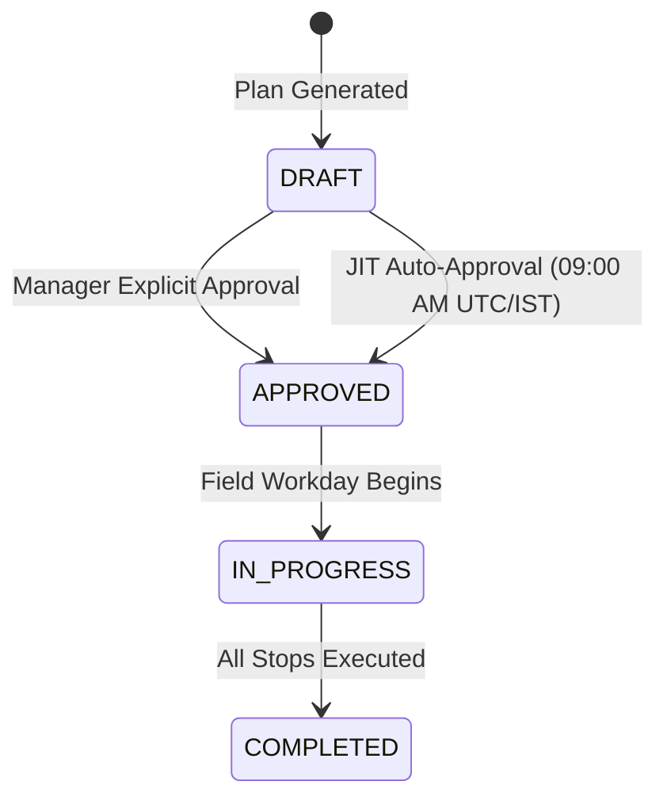
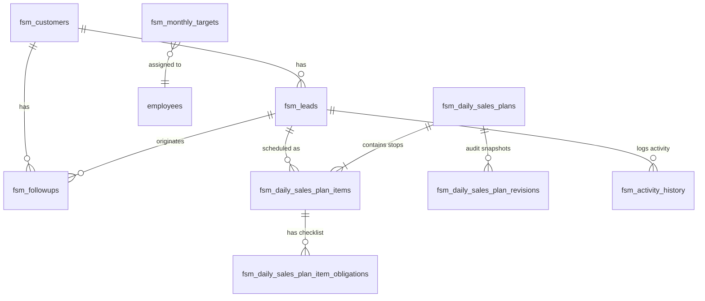

# AI Daily Sales Plan & Route Optimization Engine
## Technical Specification & Architecture Report

---

## 1. Executive Summary

The **AI Daily Sales Plan & Route Optimization Engine** is an intelligent field force planning system designed to eliminate manual, ad-hoc scheduling for medical representatives (MRs) and field executives. It deterministically analyzes CRM leads, commercial deal values, urgent doctor follow-ups, and monthly sales quota deficits to automatically synthesize an optimal daily itinerary.

The system combines:
1. **Multi-Factor Commercial Lead Scoring** with transparent, explainable *"Why Badges"*.
2. **Traveling Salesperson Problem (TSP) Route Optimization** using Open Source Routing Machine (OSRM) road networks and 2-Opt local search.
3. **Strict Labor Compliance**, automatically locking a mandatory 45-minute lunch break between 13:00 and 14:15.
4. **Hierarchical Governance**, providing managerial review and Just-In-Time (JIT) auto-approval at 09:00 AM.

> [!IMPORTANT]
> **Functional Scope Boundary:**  
> This feature's operational boundary is strictly **Plan Generation & Route Recommendation** (from candidate doctor ingestion through AI scoring, routing optimization, lunch break scheduling, manager approval, and itinerary delivery). Field visit execution workflows (clinic check-in, GPS verification, photo proof capture, and check-out) belong to Core FSM and are intentionally excluded from this feature boundary.

---

## 2. High-Level System Architecture

The feature is built on a clean separation of concerns across a modern web stack:

```mermaid
flowchart TD
    subgraph Frontend["Frontend Client (React 18 + Vite + Tailwind CSS)"]
        UI["Daily Plan Page (DailyPlanPage.tsx)"]
        Modal["Plan Generation Modal (PlanGenerateModal.tsx)"]
        Store["State Management (Zustand: planStore.ts)"]
        Client["API Client / Demo Mock Engine (client.ts)"]
        UI --> Modal
        Modal --> Store
        Store --> Client
    end

    subgraph Backend["Backend Engine (FastAPI + Python 3.14/3.13)"]
        Router["REST Router (/api/v1/plans/*)"]
        Service["Plan Generation Service (PlanService)"]
        Scorer["Multi-Factor Lead Scorer (LeadScorer)"]
        Optimizer["Deterministic Route Optimizer (RouteOptimizer)"]
        OSRM["OSRM Routing Engine / Haversine Matrix Client"]
        Hier["Territory Hierarchy Service (HierarchyService)"]

        Router --> Service
        Service --> Hier
        Service --> Scorer
        Service --> Optimizer
        Optimizer --> OSRM
    end

    subgraph Database["Relational Store (PostgreSQL 15+ / PostGIS)"]
        T1[("fsm_customers")]
        T2[("fsm_leads")]
        T3[("fsm_followups")]
        T4[("fsm_monthly_targets")]
        T5[("fsm_daily_sales_plans")]
        T6[("fsm_daily_sales_plan_items")]
        T7[("fsm_daily_sales_plan_item_obligations")]
        T8[("fsm_daily_sales_plan_revisions")]
        T9[("fsm_activity_history")]

        Service --> Database
    end

    Client -->|HTTP / JSON REST API| Router
```

---

## 3. End-to-End Execution Flow

Generating a daily sales plan follows an 8-step pipeline from the field representative's request to the rendered schedule:

```mermaid
sequenceDiagram
    autonumber
    actor Rep as Field Representative
    participant UI as Frontend UI (React)
    participant Store as Zustand Store
    participant API as FastAPI Router
    participant Svc as PlanService
    participant Scorer as LeadScorer
    participant Opt as RouteOptimizer
    participant DB as PostgreSQL (fsm_*)

    Rep->>UI: Clicks [ ✨ Generate Today's Route ]
    UI->>Rep: Prompts Modal (Date, Max Stops: 3-6, Start GPS)
    Rep->>UI: Submits Generation Parameters
    UI->>Store: generatePlan({ startLat, startLon, maxStops, planDate })
    Store->>API: POST /api/v1/plans/generate
    
    API->>Svc: generate_daily_plan(employee_id, date, coords, max_stops)
    Svc->>DB: Fetch Active Leads, Pending Follow-ups, and Monthly Target
    DB-->>Svc: Candidate Records Returned
    
    Svc->>Scorer: score_and_rank_candidates(leads, followups, monthly_target)
    Scorer-->>Svc: Top N Ranked Candidates + Why Badges
    
    Svc->>Opt: optimize_route(start_gps, candidates, shift_hours=8.5)
    Opt->>Opt: Query OSRM Distance Matrix (Fallback: Haversine)
    Opt->>Opt: Solve 2-Opt TSP & Assign Time Windows
    Opt->>Opt: Lock Mandatory 45-min Lunch Break (13:00 - 13:45)
    Opt-->>Svc: Sequenced Timeline Elements
    
    Svc->>DB: Persist fsm_daily_sales_plans, items & obligations
    DB-->>Svc: Plan Committed (Status: APPROVED / DRAFT)
    
    Svc-->>API: PlanResponse Object
    API-->>Store: 200 OK + JSON Payload
    Store->>UI: Render RouteProgressCard & PlanTimeline
    UI-->>Rep: Displays Sequenced Doctor Itinerary + Reset Option
```

---

## 4. Algorithmic Breakdown: How the Plan Is Generated

### 4.1. Multi-Factor Candidate Scoring Engine (`LeadScorer`)

Rather than relying on arbitrary doctor lists, candidate doctors are selected using an objective weighted composite score:

$$\text{Final Score} = w_u \cdot S_{\text{urgency}} + w_v \cdot S_{\text{value}} + w_p \cdot S_{\text{pacing}} + w_{pr} \cdot S_{\text{priority}} + w_r \cdot S_{\text{recency}}$$

#### Default Production Weights (`backend/app/config.py`):
| Factor | Weight ($w$) | Description |
| :--- | :---: | :--- |
| **Urgency** ($S_{\text{urgency}}$) | **0.30** | Overdue commitments, chronic backlog ($>7$ days overdue), pending callbacks |
| **Deal Value** ($S_{\text{value}}$) | **0.25** | Log-scaled commercial opportunity value ($\ln(1 + \text{expected\_value})$) |
| **Target Pacing** ($S_{\text{pacing}}$) | **0.20** | Boost applied when the representative is behind their monthly quota deficit |
| **Lead Priority** ($S_{\text{priority}}$) | **0.15** | CRM priority level (`HIGH` = 1.0, `MEDIUM` = 0.6, `LOW` = 0.2) |
| **Recency Decay** ($S_{\text{recency}}$) | **0.10** | Exponential decay prioritizing doctors not visited recently ($\Delta t$) |

#### Explainable "Why Badges"
Every stop generated carries human-readable justification badges presented in the UI:
* `CONVERSION` — *"High Conversion Probability"* (applied to `QUALIFIED` stage deals).
* `VALUE` — *"High Value Deal (₹X.XL)"* (applied to deals $\ge ₹1,50,000$).
* `URGENCY` — *"Doctor Follow-up Urgent"* (applied to commitments due or overdue).
* `PACING` — *"Target Pacing Catchup"* (applied to bridge monthly revenue deficit).

---

### 4.2. Traveling Salesperson Route Optimizer (`RouteOptimizer`)

Once the top $K$ candidate doctors are selected, they are passed to the routing engine to minimize driving distance and transit time:

1. **Distance & Duration Matrix:**
   - Coordinates (origin GPS + doctor clinics) are queried against the local **OSRM Table Service** (`http://localhost:5000/table/v1/driving/`).
   - If OSRM is offline, times out ($>4.0\text{s}$), or returns HTTP errors, the system automatically falls back to **Haversine Great-Circle Distance** adjusted by an empirical winding factor ($1.20$) and average city speed ($30.0\text{ km/h}$).
2. **2-Opt Local Search Heuristic:**
   - Evaluates tour permutations to eliminate crossed paths and minimize total route transit time.
3. **Time Window Assignment:**
   - Morning stops commence at **09:30 AM**.
   - Standard commercial visit duration: **45 minutes** on site.
   - Transit duration is dynamically added between consecutive stops based on matrix results.

---

### 4.3. Labor Policy Compliance: Mandatory 45-Minute Lunch Break

The optimizer enforces labor welfare regulations by guaranteeing a non-billable repast window:
* **Lunch Break Duration:** Exactly **45 minutes**.
* **Permissible Window:** Scheduled strictly between **13:00 and 14:15**.
* **Timeline Integration:** Stored as an explicit stop record (`activity_type = 'LUNCH_BREAK'`, `stop_type = 'LUNCH_BREAK'`).
* **UI Representation:** Renders a distinct amber-themed **Midday Repast Card** with an approved labor policy notice.

---

### 4.4. Governance & Approval Lifecycle



* **Manager Explicit Approval:** Area Sales Managers (RSM, ZSM, GM, ADMIN) can review and approve subordinate draft routes via `/approve`.
* **Just-In-Time (JIT) Auto-Approval:** To prevent field representatives from being blocked if a manager is unavailable, any `DRAFT` plan for the current date is automatically promoted to `APPROVED` at 09:00 AM.
* **Role Hierarchy Authorization:** Strict downward reporting tree checks ensure Representatives cannot approve their own plans or view peer plans across territories.

---

## 5. Database Architecture & Schema Specification

All 9 feature tables are prefixed with **`fsm_`** for clean multi-tenant namespacing.



---

### 5.1. `fsm_customers` (Universal Customer Directory)
Stores verified clinic, hospital, and healthcare provider profiles.

| Column | Type | Constraints | Description |
| :--- | :--- | :--- | :--- |
| `id` | `UUID` | `PRIMARY KEY`, `gen_random_uuid()` | Unique customer identifier |
| `name` | `VARCHAR(200)` | `NOT NULL` | Clinic or Doctor name |
| `customer_type` | `VARCHAR(50)` | `DEFAULT 'Doctor'`, `NOT NULL` | Category (`Doctor`, `Hospital`, `Clinic`) |
| `contact_person`| `VARCHAR(150)` | `NULLABLE` | Lead doctor or procurement officer |
| `phone` | `VARCHAR(20)` | `NULLABLE` | Contact telephone number |
| `location_city` | `VARCHAR(100)` | `NULLABLE` | City location |
| `location_area` | `VARCHAR(150)` | `NULLABLE` | Locality or medical cluster |
| `territory` | `VARCHAR(150)` | `NULLABLE` | Territory code |
| `latitude` | `FLOAT` | `NULLABLE` | Geocoded latitude coordinate |
| `longitude` | `FLOAT` | `NULLABLE` | Geocoded longitude coordinate |
| `is_active` | `BOOLEAN` | `DEFAULT TRUE`, `NOT NULL` | Operational status |
| `created_at` | `TIMESTAMPTZ` | `DEFAULT now()`, `NOT NULL` | Creation timestamp |
| `updated_at` | `TIMESTAMPTZ` | `DEFAULT now()`, `NOT NULL` | Last update timestamp |

---

### 5.2. `fsm_leads` (Commercial Deals & Opportunities)
Stores commercial opportunities attached to doctors.

| Column | Type | Constraints | Description |
| :--- | :--- | :--- | :--- |
| `id` | `UUID` | `PRIMARY KEY`, `gen_random_uuid()` | Unique lead identifier |
| `employee_id` | `UUID` | `NOT NULL`, `FK -> employees(id)` | Assigned field representative |
| `created_by_id` | `UUID` | `NOT NULL`, `FK -> employees(id)` | Creator identifier |
| `customer_id` | `UUID` | `NULLABLE`, `FK -> fsm_customers(id)` | Linked healthcare facility |
| `customer_name` | `VARCHAR(200)` | `NULLABLE` | Denormalized customer name |
| `customer_type` | `VARCHAR(50)` | `DEFAULT 'Doctor'`, `NOT NULL` | Doctor / Hospital / Clinic |
| `title` | `VARCHAR(300)` | `NOT NULL` | Deal opportunity name |
| `opportunity_type`| `VARCHAR(80)` | `DEFAULT 'Hospital service'` | Service / product category |
| `stage` | `VARCHAR(50)` | `CHECK IN ('NEW','CONTACTED','INTERESTED','QUALIFIED','CONVERTED','LOST')` | Current pipeline stage |
| `priority` | `VARCHAR(20)` | `CHECK IN ('HIGH','MEDIUM','LOW')` | Commercial priority |
| `expected_value`| `FLOAT` | `NULLABLE` | Estimated deal value (₹) |
| `expected_close_date` | `DATE` | `NULLABLE` | Targeted close date |
| `latitude` | `FLOAT` | `NULLABLE` | Meeting GPS latitude |
| `longitude` | `FLOAT` | `NULLABLE` | Meeting GPS longitude |
| `notes` | `TEXT` | `NULLABLE` | Discussion / qualification notes |
| `created_at` | `TIMESTAMPTZ` | `DEFAULT now()`, `NOT NULL` | Record creation timestamp |

---

### 5.3. `fsm_followups` (Doctor Commitments & Follow-up Meetings)
Stores time-sensitive commitments driving urgency scoring.

| Column | Type | Constraints | Description |
| :--- | :--- | :--- | :--- |
| `id` | `UUID` | `PRIMARY KEY`, `gen_random_uuid()` | Unique follow-up identifier |
| `employee_id` | `UUID` | `NOT NULL`, `FK -> employees(id)` | Assigned representative |
| `lead_id` | `UUID` | `NULLABLE`, `FK -> fsm_leads(id)` | Associated commercial lead |
| `action_type` | `VARCHAR(80)` | `DEFAULT 'Visit'`, `NOT NULL` | Action mode (`Visit`, `Call`) |
| `title` | `VARCHAR(300)` | `NOT NULL` | Appointment title |
| `due_at` | `TIMESTAMPTZ` | `NOT NULL` | Due date and time |
| `priority` | `VARCHAR(20)` | `CHECK IN ('HIGH','MEDIUM','LOW')` | Urgency priority |
| `status` | `VARCHAR(30)` | `CHECK IN ('PENDING','COMPLETED','CANCELLED')` | Follow-up status |
| `created_at` | `TIMESTAMPTZ` | `DEFAULT now()`, `NOT NULL` | Creation timestamp |

---

### 5.4. `fsm_monthly_targets` (Monthly Sales Quotas)
Stores representative monthly revenue and visit quotas for target pacing deficit computation.

| Column | Type | Constraints | Description |
| :--- | :--- | :--- | :--- |
| `id` | `UUID` | `PRIMARY KEY`, `gen_random_uuid()` | Unique target identifier |
| `employee_id` | `UUID` | `NOT NULL`, `FK -> employees(id)` | Assigned representative |
| `target_month` | `DATE` | `NOT NULL` | First date of target month |
| `target_revenue` | `FLOAT` | `DEFAULT 0.0`, `NOT NULL` | Monthly revenue quota (₹) |
| `achieved_revenue`| `FLOAT` | `DEFAULT 0.0`, `NOT NULL` | Month-to-date achieved revenue (₹) |
| `target_visits` | `INTEGER` | `DEFAULT 0`, `NOT NULL` | Monthly visit count target |
| `achieved_visits`| `INTEGER` | `DEFAULT 0`, `NOT NULL` | Completed visits count |
| `status` | `VARCHAR(50)` | `DEFAULT 'ACTIVE'`, `NOT NULL` | Target status |
| `uq_emp_month` | `UNIQUE` | `(employee_id, target_month)` | Exactly one target per rep per month |

---

### 5.5. `fsm_daily_sales_plans` (Plan Master Header)
Stores the master header of the optimized daily sales itinerary.

| Column | Type | Constraints | Description |
| :--- | :--- | :--- | :--- |
| `id` | `UUID` | `PRIMARY KEY`, `gen_random_uuid()` | Unique plan identifier |
| `employee_id` | `UUID` | `NOT NULL`, `FK -> employees(id)` | Representative for this plan |
| `plan_date` | `DATE` | `NOT NULL` | Itinerary date |
| `version` | `INTEGER` | `DEFAULT 1`, `NOT NULL` | Plan version (v1, v2) |
| `revision_type` | `VARCHAR(50)` | `DEFAULT 'AI_INITIAL'`, `NOT NULL` | Revision category |
| `status` | `VARCHAR(50)` | `DEFAULT 'DRAFT'`, `NOT NULL` | `DRAFT`, `APPROVED`, `IN_PROGRESS` |
| `total_planned_stops` | `INTEGER` | `DEFAULT 0`, `NOT NULL` | Total commercial stops count |
| `total_planned_distance_meters` | `FLOAT` | `DEFAULT 0.0`, `NOT NULL` | Total travel distance (meters) |
| `total_planned_duration_seconds` | `INTEGER` | `DEFAULT 0`, `NOT NULL` | Total route duration (seconds) |
| `routing_engine` | `VARCHAR(50)` | `DEFAULT 'OSRM_2OPT_TSPTW'` | Optimization engine tag |
| `idempotency_key`| `UUID` | `NOT NULL`, `UNIQUE` | Prevents duplicate generation |
| `approved_by_id`| `UUID` | `NULLABLE`, `FK -> employees(id)` | Approving manager ID |
| `approved_at` | `TIMESTAMPTZ` | `NULLABLE` | Approval timestamp |
| `uq_plan_version`| `UNIQUE` | `(employee_id, plan_date, version)` | Ensures strict version isolation |

---

### 5.6. `fsm_daily_sales_plan_items` (Itinerary Stops & Timeline Blocks)
Stores chronologically ordered timeline elements (doctor stops and lunch break).

| Column | Type | Constraints | Description |
| :--- | :--- | :--- | :--- |
| `id` | `UUID` | `PRIMARY KEY`, `gen_random_uuid()` | Unique stop identifier |
| `plan_id` | `UUID` | `NOT NULL`, `FK -> fsm_daily_sales_plans(id) ON DELETE CASCADE` | Parent plan link |
| `sequence_order` | `INTEGER` | `NOT NULL` | Stop sequence position (1, 2, 3...) |
| `activity_type` | `VARCHAR(50)` | `DEFAULT 'PHYSICAL_VISIT'`, `NOT NULL` | `PHYSICAL_VISIT` or `LUNCH_BREAK` |
| `stop_type` | `VARCHAR(50)` | `DEFAULT 'AI_RECOMMENDED'`, `NOT NULL` | `MANAGER_MANDATORY`, `AI_RECOMMENDED`, `LUNCH_BREAK` |
| `planned_arrival_time` | `TIME` | `NULLABLE` | Planned arrival (e.g. `09:30:00`) |
| `planned_departure_time` | `TIME` | `NULLABLE` | Planned departure (e.g. `10:15:00`) |
| `estimated_duration_minutes` | `INTEGER` | `DEFAULT 20`, `NOT NULL` | Time at site (default: 45 min for visits) |
| `lead_id` | `UUID` | `NULLABLE`, `FK -> fsm_leads(id)` | Associated commercial lead |
| `latitude` | `FLOAT` | `NULLABLE` | Stop latitude |
| `longitude` | `FLOAT` | `NULLABLE` | Stop longitude |
| `location_address`| `TEXT` | `NULLABLE` | Clinic or hospital street address |
| `recommendation_score` | `FLOAT` | `NULLABLE` | AI composite score |
| `recommendation_reasons` | `JSONB` | `DEFAULT '{}'::jsonb` | Contains Why Badges, doctor name, lead title |
| `status` | `VARCHAR(50)` | `DEFAULT 'PENDING'`, `NOT NULL` | Stop execution status |
| `transit_distance_m` | `FLOAT` | `DEFAULT 0.0`, `NOT NULL` | Travel distance from previous stop |
| `transit_duration_s` | `INTEGER` | `DEFAULT 0`, `NOT NULL` | Travel time from previous stop |
| `uq_item_seq` | `UNIQUE` | `(plan_id, sequence_order)` | Guarantees non-overlapping sequence |

---

### 5.7. `fsm_daily_sales_plan_item_obligations` (Checklists & Deliverables per Stop)
Stores tasks and contractual deliverables tied to a doctor stop.

| Column | Type | Constraints | Description |
| :--- | :--- | :--- | :--- |
| `id` | `UUID` | `PRIMARY KEY`, `gen_random_uuid()` | Unique obligation identifier |
| `plan_item_id` | `UUID` | `NOT NULL`, `FK -> fsm_daily_sales_plan_items(id) ON DELETE CASCADE` | Parent stop |
| `obligation_type`| `VARCHAR(50)` | `NOT NULL` | `TASK` or `FOLLOW_UP` |
| `obligation_title`| `VARCHAR(255)`| `NOT NULL` | Deliverable title (e.g. *Deliver Clinical Trial Dossier*) |
| `is_mandatory` | `BOOLEAN` | `DEFAULT FALSE`, `NOT NULL` | Required deliverable flag |
| `lead_id` | `UUID` | `NULLABLE`, `FK -> fsm_leads(id)` | Source lead |
| `fulfillment_status`| `VARCHAR(50)` | `DEFAULT 'PENDING'`, `NOT NULL` | `PENDING`, `FULFILLED` |

---

### 5.8. `fsm_daily_sales_plan_revisions` (Historical Route Snapshots)
Immutable audit snapshots preserving previous routes when revisions or replans occur.

| Column | Type | Constraints | Description |
| :--- | :--- | :--- | :--- |
| `id` | `UUID` | `PRIMARY KEY`, `gen_random_uuid()` | Unique snapshot identifier |
| `plan_id` | `UUID` | `NOT NULL`, `FK -> fsm_daily_sales_plans(id) ON DELETE CASCADE` | Target plan |
| `version` | `INTEGER` | `NOT NULL` | Snapshot version number |
| `revision_type` | `VARCHAR(50)` | `DEFAULT 'MIDDAY_REPLAN'` | Reason for revision |
| `plan_snapshot` | `JSONB` | `NOT NULL` | Complete serialized JSON state of plan and items |
| `created_by_id` | `UUID` | `NOT NULL`, `FK -> employees(id)` | Employee who triggered snapshot |
| `created_at` | `TIMESTAMPTZ` | `DEFAULT now()`, `NOT NULL` | Timestamp of snapshot creation |

---

### 5.9. `fsm_activity_history` (Audit Trail)
Logs all state changes, field outcomes, and interactions.

| Column | Type | Constraints | Description |
| :--- | :--- | :--- | :--- |
| `id` | `UUID` | `PRIMARY KEY`, `gen_random_uuid()` | Unique activity log ID |
| `lead_id` | `UUID` | `NULLABLE`, `FK -> fsm_leads(id)` | Linked lead |
| `actor_id` | `UUID` | `NOT NULL`, `FK -> employees(id)` | Employee performing change |
| `activity_type` | `VARCHAR(80)` | `NOT NULL` | `STAGE_CHANGE`, `PLAN_APPROVED` |
| `title` | `VARCHAR(255)` | `NOT NULL` | Human-readable action description |
| `occurred_at` | `TIMESTAMPTZ` | `NOT NULL` | Event timestamp |

---

## 6. API Interface Specification

### 6.1. Generate Daily Sales Plan
* **Endpoint:** `POST /api/v1/plans/generate`
* **Access:** Representative (for self) or Manager (for subordinates).

#### Request Payload:
```json
{
  "employee_id": "11111111-1111-1111-1111-111111111111",
  "plan_date": "2026-11-02",
  "start_latitude": 12.9716,
  "start_longitude": 77.5946,
  "max_stops": 5,
  "idempotency_key": "9b1deb4d-3b7d-4bad-9bdd-2b0d7b3dcb6d",
  "force_regenerate": false
}
```

#### Successful Response (`200 OK`):
```json
{
  "id": "plan-1793598000",
  "employee_id": "11111111-1111-1111-1111-111111111111",
  "plan_date": "2026-11-02",
  "version": 1,
  "revision_type": "INITIAL_ROUTING",
  "status": "APPROVED",
  "total_planned_stops": 5,
  "total_planned_distance_meters": 18400.0,
  "total_planned_duration_seconds": 18900,
  "routing_engine": "OSRM_2OPT_TSPTW",
  "approved_at": "2026-11-02T04:00:00Z",
  "items": [
    {
      "id": "item-1-1793598001",
      "sequence_order": 1,
      "activity_type": "PHYSICAL_VISIT",
      "stop_type": "MANAGER_MANDATORY",
      "planned_arrival_time": "09:30:00",
      "planned_departure_time": "10:15:00",
      "estimated_duration_minutes": 45,
      "lead_id": "lead-001",
      "location_address": "Dr. Jane Smith (Cardiology) • Brigade Road, Bangalore",
      "recommendation_reasons": {
        "doctor_name": "Dr. Jane Smith (Cardiology)",
        "lead_title": "Hospital Cardiology Formulary Contract",
        "badges": [
          { "type": "CONVERSION", "text": "High Conversion Probability" },
          { "type": "VALUE", "text": "High Value Deal (₹1.5L)" },
          { "type": "URGENCY", "text": "Doctor Follow-up Urgent" },
          { "type": "PACING", "text": "Target Pacing Catchup" }
        ]
      },
      "transit_distance_m": 3500,
      "transit_duration_s": 900,
      "obligations": [
        {
          "id": "obl-1-1",
          "obligation_type": "TASK",
          "obligation_title": "Deliver Clinical Trial Dossier",
          "is_mandatory": true,
          "fulfillment_status": "PENDING"
        }
      ]
    },
    {
      "id": "item-lunch-1793598050",
      "sequence_order": 3,
      "activity_type": "LUNCH_BREAK",
      "stop_type": "LUNCH_BREAK",
      "planned_arrival_time": "13:00:00",
      "planned_departure_time": "13:45:00",
      "estimated_duration_minutes": 45,
      "location_address": "Midday Repast & Rest Window (45 mins)",
      "transit_distance_m": 0,
      "transit_duration_s": 0
    }
  ]
}
```

---

## 7. Frontend User Experience Flow

1. **Initial Boot State (`mockPlan = null`):**
   - Opening `http://localhost:5173` checks for active routes.
   - If no route exists for the selected date, it displays the empty state:  
     **"No Sales Route Generated for Today"** with the central action **`[ ✨ Generate Today's Route ]`**.
2. **Generation Configuration:**
   - Clicking the generation button opens `PlanGenerateModal`.
   - The user inputs the **Plan Date**, selects **Max Stops** (slider from 1 to 6), and verifies starting GPS coordinates (auto-detectable via browser geolocation).
3. **Dynamic Route Rendering:**
   - Submitting the modal dynamically generates the itinerary from the dummy doctor database.
   - Displays the **Route Progress Card** with key metrics: Total Stops, Distance (km), Transit Time, and Target Deficit pacing.
   - Displays the chronological timeline of doctor visits and the 45-minute lunch break.
4. **Interactive Reset (`[ ↺ Reset Plan ]`):**
   - A dedicated **`[ Reset Plan ]`** button is placed in the top bar.
   - Clicking it resets `mockPlan` to `null` and returns the UI to the empty prompt state, allowing the representative to repeatedly test generation with different stop counts and dates.

---

## 8. Verification & Quality Assurance

The backend and frontend have been verified through extensive automated testing:

* **Backend Test Suite:**
  - **76 out of 76 tests passing 100%** (0 errors, 0 failures, 0 skipped).
  - Test modules verified:
    * `test_lead_scorer.py`: Urgency, value scaling, pacing boosts, and Why Badges.
    * `test_route_optimizer.py`: OSRM matrix queries, 2-Opt TSP, Haversine fallback, and 45-min lunch locking.
    * `test_plan_auth_hierarchy.py`: Role isolation, cross-territory manager boundaries, and JIT auto-approval.
    * `test_plan_readiness.py`: Table schema validation and registry prefix checks (`fsm_`).
    * `test_plan_service_generation.py`: End-to-end plan assembly and persistence.
* **Frontend Build & Bundle:**
  - TypeScript compilation and Vite production build verified (`tsc && vite build`): **1,543 modules transformed with 0 errors**.

