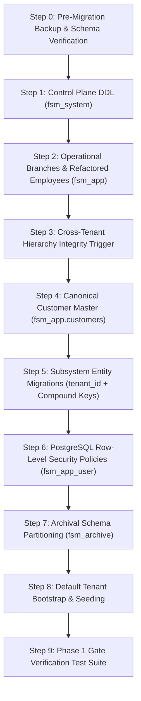

# Implementation Plan: Enterprise Multi-Tenant & Multi-Branch Architecture (Phase 1)

**Target System**: Field Force Master Platform  
**Architecture Spec**: [`docs/Multi-Tenant Architecture Specification (1).pdf`](file:///c:/Users/harin/Downloads/fsm/docs/Multi-Tenant%20Architecture%20Specification%20%281%29.pdf) (v2.0-MultiTenant)  
**Deliverable**: Phase 1 — Schema, DDL Migration, Data Isolation & RLS Infrastructure  
**Target Database**: PostgreSQL 15+ / Supabase Hosted Database  

---

## 1. Phase 1 Goal & Scope

The objective of **Phase 1** is to execute the database schema refactoring and deploy kernel-enforced data isolation mechanisms before touching the application gateway or business logic:

1. **Schema Partitioning**: Establish the three dedicated database schemas (`fsm_system`, `fsm_app`, `fsm_archive`).
2. **Control Plane Provisioning (`fsm_system`)**: Deploy `tenants`, `tenant_features`, and `tenant_branding`.
3. **Two-Tier Organization Setup (`fsm_app`)**: Deploy `branches` and refactor `employees` with `tenant_id`, `branch_id`, and `is_tenant_root_admin`.
4. **Hierarchy Integrity Trigger**: Enforce `trg_employee_tenant_integrity` at the PostgreSQL level to mathematically eliminate cross-company reporting manager relationships.
5. **Canonical Customer Master (`fsm_app.customers`)**: Consolidate siloed customer directories (doctors, clinics, farmers, industrial plants) into a single unified directory.
6. **Multi-Tenant Column Migration (`tenant_id`)**: Add non-nullable `tenant_id` foreign keys and compound unique keys (`UNIQUE(tenant_id, ...)`) across all core operational tables.
7. **PostgreSQL Row-Level Security (RLS)**: Enforce `FORCE ROW LEVEL SECURITY` across all operational tables with dynamic session variable leasing (`app.current_tenant_id`).
8. **Automated Rollback & Verification**: Provide clean rollback scripts and a repeatable SQL verification test suite.

---

## 2. Execution Sequence & Dependencies



---

## 3. Detailed Step-by-Step Execution Plan

### Step 1: Control Plane DDL (`fsm_system`)
* **Objective**: Create the platform control plane to store client subscriptions, features, and white-label branding.
* **SQL Deliverable**: `sql/01_tenant_control_plane.sql`
* **Tables Created**:
  * `fsm_system.tenants`: Core corporate paying organization entity.
  * `fsm_system.tenant_features`: Granular feature toggle per client.
  * `fsm_system.tenant_branding`: White-label UI theme and dynamic terminology mappings (e.g., `{"target": "Doctor", "visit": "DCR Call"}`).

### Step 2: Operational Branches & Refactored Employees (`fsm_app`)
* **Objective**: Model the two-tier organizational hierarchy (Tenant &times; Branch).
* **SQL Deliverable**: `sql/02_branches_and_employees.sql`
* **Modifications**:
  * Create `fsm_app.branches` with `UNIQUE (tenant_id, branch_code)`.
  * Add columns to `fsm_app.employees`:
    * `tenant_id UUID NOT NULL REFERENCES fsm_system.tenants(id) ON DELETE CASCADE`
    * `branch_id UUID REFERENCES fsm_app.branches(id) ON DELETE SET NULL` (`NULL` represents National Scope)
    * `is_tenant_root_admin BOOLEAN NOT NULL DEFAULT FALSE`
  * Replace global unique email constraint with compound key:
    * `ALTER TABLE fsm_app.employees DROP CONSTRAINT IF EXISTS employees_email_key;`
    * `ALTER TABLE fsm_app.employees ADD CONSTRAINT uq_employees_tenant_email UNIQUE (tenant_id, email);`

### Step 3: Cross-Tenant Hierarchy Integrity Trigger
* **Objective**: Guarantee that an employee cannot report to a manager from another company, even if an application bug attempts it.
* **Function**: `fsm_app.validate_employee_tenant_integrity()`
* **Trigger**: `trg_employee_tenant_integrity` on `fsm_app.employees`.

### Step 4: Canonical Customer Master (`fsm_app.customers`)
* **Objective**: Harmonize doctor, chemist, farmer, and facility directories into a canonical entity usable by CRM leads, follow-ups, and route plans.
* **SQL Deliverable**: `sql/03_canonical_customers.sql`
* **Table Created**: `fsm_app.customers` with `(tenant_id, branch_id, name, customer_type, location_city, latitude, longitude)`.

### Step 5: Subsystem Entity Migrations (`tenant_id` + Compound Keys)
* **Objective**: Add `tenant_id` discriminator and compound indexes across all audited subsystems.
* **Scope of Subsystems**:
  1. **Field Travel & Work**: `field_sessions`, `field_visits`, `leave_requests`, `leave_balances`, `tasks`.
  2. **Attendance & Telemetry**: `attendance`, `breaks`, `office_locations`.
  3. **CRM Opportunities & Commitments**: `leads`, `lead_history`, `followups`, `followup_history`.
  4. **Expense Management**: `expenses`, `disbursements`.
  5. **Monthly Targets & Revenue Leakage**: `monthly_targets`, `target_progress_entries`, `revenue_leakage_rules` (`UNIQUE(tenant_id, rule_code)`).
* **Compound Key Invariant**: Replace all business unique keys with `(tenant_id, business_key)`.

### Step 6: PostgreSQL Row-Level Security (RLS) & Role Lockdown
* **Objective**: Provide zero-leakage security guarantees enforced by the database engine.
* **Role Configuration**: Ensure unprivileged role `fsm_app_user` owns table execution.
* **Policy Rule**:
  ```sql
  ALTER TABLE fsm_app.<table_name> ENABLE ROW LEVEL SECURITY;
  ALTER TABLE fsm_app.<table_name> FORCE ROW LEVEL SECURITY;

  CREATE POLICY tenant_isolation_policy ON fsm_app.<table_name>
  FOR ALL TO fsm_app_user
  USING (tenant_id = NULLIF(current_setting('app.current_tenant_id', true), '')::uuid)
  WITH CHECK (tenant_id = NULLIF(current_setting('app.current_tenant_id', true), '')::uuid);
  ```
* **Security Invariant**: If `app.current_tenant_id` is missing or invalid, PostgreSQL returns `0 rows` and denies inserts.

### Step 7: Archival Schema Partitioning (`fsm_archive`)
* **Objective**: Create `fsm_archive` schema to support the 3-tier hot/warm/cold archiving strategy.

### Step 8: Default Tenant Bootstrap & Seeding
* **Objective**: Seed a default reference tenant (e.g. `zydus` or `default-corp`) and HQ branch so local development and tests run immediately without broken foreign keys.

---

## 4. DDL Blueprints (Executable SQL)

### Script 1: `sql/01_tenant_control_plane.sql`
```sql
-- ==============================================================================
-- 01_tenant_control_plane.sql: SaaS Control Plane Schema & Contracts
-- ==============================================================================

CREATE SCHEMA IF NOT EXISTS fsm_system;

-- 1. Corporate Tenants
CREATE TABLE IF NOT EXISTS fsm_system.tenants (
    id UUID PRIMARY KEY DEFAULT gen_random_uuid(),
    slug VARCHAR(63) NOT NULL UNIQUE,
    legal_name VARCHAR(255) NOT NULL,
    trade_name VARCHAR(255),
    is_active BOOLEAN NOT NULL DEFAULT TRUE,
    subscription_tier VARCHAR(50) NOT NULL DEFAULT 'standard',
    created_at TIMESTAMPTZ NOT NULL DEFAULT NOW(),
    updated_at TIMESTAMPTZ NOT NULL DEFAULT NOW()
);

-- 2. Tenant Dynamic Feature Entitlements
CREATE TABLE IF NOT EXISTS fsm_system.tenant_features (
    id UUID PRIMARY KEY DEFAULT gen_random_uuid(),
    tenant_id UUID NOT NULL REFERENCES fsm_system.tenants(id) ON DELETE CASCADE,
    feature_key VARCHAR(50) NOT NULL,
    is_enabled BOOLEAN NOT NULL DEFAULT TRUE,
    created_at TIMESTAMPTZ NOT NULL DEFAULT NOW(),
    CONSTRAINT uq_tenant_feature UNIQUE (tenant_id, feature_key)
);

-- 3. Tenant White-Label Branding & Vocabulary Dictionary
CREATE TABLE IF NOT EXISTS fsm_system.tenant_branding (
    tenant_id UUID PRIMARY KEY REFERENCES fsm_system.tenants(id) ON DELETE CASCADE,
    brand_name VARCHAR(100) NOT NULL,
    logo_url TEXT,
    primary_color VARCHAR(20) DEFAULT '#00897B',
    terminology_mapping JSONB NOT NULL DEFAULT '{"target":"Doctor","visit":"DCR Call"}'::jsonb,
    updated_at TIMESTAMPTZ NOT NULL DEFAULT NOW()
);

-- Grants
GRANT USAGE ON SCHEMA fsm_system TO fsm_app_user;
GRANT SELECT ON ALL TABLES IN SCHEMA fsm_system TO fsm_app_user;
```

---

### Script 2: `sql/02_branches_and_hierarchy.sql`
```sql
-- ==============================================================================
-- 02_branches_and_hierarchy.sql: Two-Tier Organization & Employee Integrity
-- ==============================================================================

-- 1. Operational Branches
CREATE TABLE IF NOT EXISTS fsm_app.branches (
    id UUID PRIMARY KEY DEFAULT gen_random_uuid(),
    tenant_id UUID NOT NULL REFERENCES fsm_system.tenants(id) ON DELETE CASCADE,
    name VARCHAR(150) NOT NULL,
    branch_code VARCHAR(50) NOT NULL,
    city VARCHAR(100) NOT NULL,
    is_head_office BOOLEAN NOT NULL DEFAULT FALSE,
    is_active BOOLEAN NOT NULL DEFAULT TRUE,
    created_at TIMESTAMPTZ NOT NULL DEFAULT NOW(),
    CONSTRAINT uq_branches_tenant_code UNIQUE (tenant_id, branch_code)
);

-- 2. Add Multi-Tenant Columns to Employees
DO $$ 
BEGIN 
    IF NOT EXISTS (SELECT 1 FROM information_schema.columns WHERE table_schema='fsm_app' AND table_name='employees' AND column_name='tenant_id') THEN
        ALTER TABLE fsm_app.employees ADD COLUMN tenant_id UUID REFERENCES fsm_system.tenants(id) ON DELETE CASCADE;
    END IF;

    IF NOT EXISTS (SELECT 1 FROM information_schema.columns WHERE table_schema='fsm_app' AND table_name='employees' AND column_name='branch_id') THEN
        ALTER TABLE fsm_app.employees ADD COLUMN branch_id UUID REFERENCES fsm_app.branches(id) ON DELETE SET NULL;
    END IF;

    IF NOT EXISTS (SELECT 1 FROM information_schema.columns WHERE table_schema='fsm_app' AND table_name='employees' AND column_name='is_tenant_root_admin') THEN
        ALTER TABLE fsm_app.employees ADD COLUMN is_tenant_root_admin BOOLEAN NOT NULL DEFAULT FALSE;
    END IF;
END $$;

-- 3. Cross-Tenant Hierarchy Integrity Trigger
CREATE OR REPLACE FUNCTION fsm_app.validate_employee_tenant_integrity() 
RETURNS TRIGGER AS $$ 
BEGIN 
    IF NEW.reporting_to_id IS NOT NULL THEN 
        IF NOT EXISTS ( 
            SELECT 1 FROM fsm_app.employees 
            WHERE id = NEW.reporting_to_id AND tenant_id = NEW.tenant_id 
        ) THEN 
            RAISE EXCEPTION 'Integrity Error: Reporting manager must belong to the exact same tenant.'; 
        END IF; 
    END IF; 
    RETURN NEW; 
END; 
$$ LANGUAGE plpgsql;

DROP TRIGGER IF EXISTS trg_employee_tenant_integrity ON fsm_app.employees;
CREATE TRIGGER trg_employee_tenant_integrity 
BEFORE INSERT OR UPDATE ON fsm_app.employees 
FOR EACH ROW EXECUTE FUNCTION fsm_app.validate_employee_tenant_integrity();
```

---

### Script 3: `sql/03_canonical_customers.sql`
```sql
-- ==============================================================================
-- 03_canonical_customers.sql: Unified Customer Master
-- ==============================================================================

CREATE TABLE IF NOT EXISTS fsm_app.customers (
    id UUID PRIMARY KEY DEFAULT gen_random_uuid(),
    tenant_id UUID NOT NULL REFERENCES fsm_system.tenants(id) ON DELETE CASCADE,
    branch_id UUID REFERENCES fsm_app.branches(id) ON DELETE SET NULL,
    name VARCHAR(200) NOT NULL,
    customer_type VARCHAR(50) NOT NULL DEFAULT 'Doctor',
    phone VARCHAR(20),
    contact_person VARCHAR(150),
    location_city VARCHAR(100),
    latitude DOUBLE PRECISION,
    longitude DOUBLE PRECISION,
    is_active BOOLEAN NOT NULL DEFAULT TRUE,
    created_at TIMESTAMPTZ NOT NULL DEFAULT NOW()
);

CREATE INDEX IF NOT EXISTS ix_customers_tenant_type ON fsm_app.customers(tenant_id, customer_type);
```

---

### Script 4: `sql/04_rls_policies.sql`
```sql
-- ==============================================================================
-- 04_rls_policies.sql: PostgreSQL Row-Level Security Policies
-- ==============================================================================

-- List of operational tables requiring RLS
DO $$ 
DECLARE
    tbl TEXT;
    target_tables TEXT[] := ARRAY[
        'branches', 'employees', 'customers', 'office_locations', 
        'attendance', 'breaks', 'field_sessions', 'field_visits', 
        'leave_requests', 'leave_balances', 'tasks', 'expenses', 
        'leads', 'lead_history', 'followups', 'followup_history'
    ];
BEGIN 
    FOREACH tbl IN ARRAY target_tables LOOP
        IF EXISTS (SELECT 1 FROM information_schema.tables WHERE table_schema = 'fsm_app' AND table_name = tbl) THEN
            EXECUTE format('ALTER TABLE fsm_app.%I ENABLE ROW LEVEL SECURITY;', tbl);
            EXECUTE format('ALTER TABLE fsm_app.%I FORCE ROW LEVEL SECURITY;', tbl);
            
            EXECUTE format('DROP POLICY IF EXISTS tenant_isolation_policy ON fsm_app.%I;', tbl);
            EXECUTE format(
                'CREATE POLICY tenant_isolation_policy ON fsm_app.%I ' ||
                'FOR ALL TO fsm_app_user ' ||
                'USING (tenant_id = NULLIF(current_setting(''app.current_tenant_id'', true), '''信)::uuid) ' ||
                'WITH CHECK (tenant_id = NULLIF(current_setting(''app.current_tenant_id'', true), '''信)::uuid);',
                tbl
            );
        END IF;
    END LOOP;
END $$;
```

---

## 5. Phase 1 Gate Verification Test Suite

Before declaring Phase 1 complete, the following SQL test cases must pass:

| Test ID | Test Scenario | Expected Outcome |
| :--- | :--- | :--- |
| **T-1** | Query `fsm_app.employees` as `fsm_app_user` with **no tenant variable set** | **Zero rows returned** (empty set). No errors, no data leakage. |
| **T-2** | Insert into `fsm_app.leads` without setting `app.current_tenant_id` | **Rejected** by PostgreSQL RLS check constraint. |
| **T-3** | Set `SET LOCAL app.current_tenant_id = '<Tenant-A-UUID>'` and query `customers` | Returns **only Tenant A customers**. Zero Tenant B records visible. |
| **T-4** | Attempt to insert an employee with `reporting_to_id` belonging to a **different tenant** | **Aborted with Exception**: `'Integrity Error: Reporting manager must belong to the exact same tenant.'` |
| **T-5** | Insert duplicate email across two **different tenants** | **Allowed** (`UNIQUE(tenant_id, email)` allows same email in different organizations). |
| **T-6** | Insert duplicate email within the **same tenant** | **Rejected** by `uq_employees_tenant_email`. |

---

## 6. Rollback Blueprint

Every migration script in Phase 1 has a corresponding `.rollback.sql`:

1. `sql/04_rls_policies.rollback.sql`: Drops RLS policies on all operational tables.
2. `sql/03_canonical_customers.rollback.sql`: Drops `fsm_app.customers`.
3. `sql/02_branches_and_hierarchy.rollback.sql`: Drops trigger, drops `fsm_app.branches`, restores single-tenant unique keys.
4. `sql/01_tenant_control_plane.rollback.sql`: Drops `fsm_system` schema and tables.
