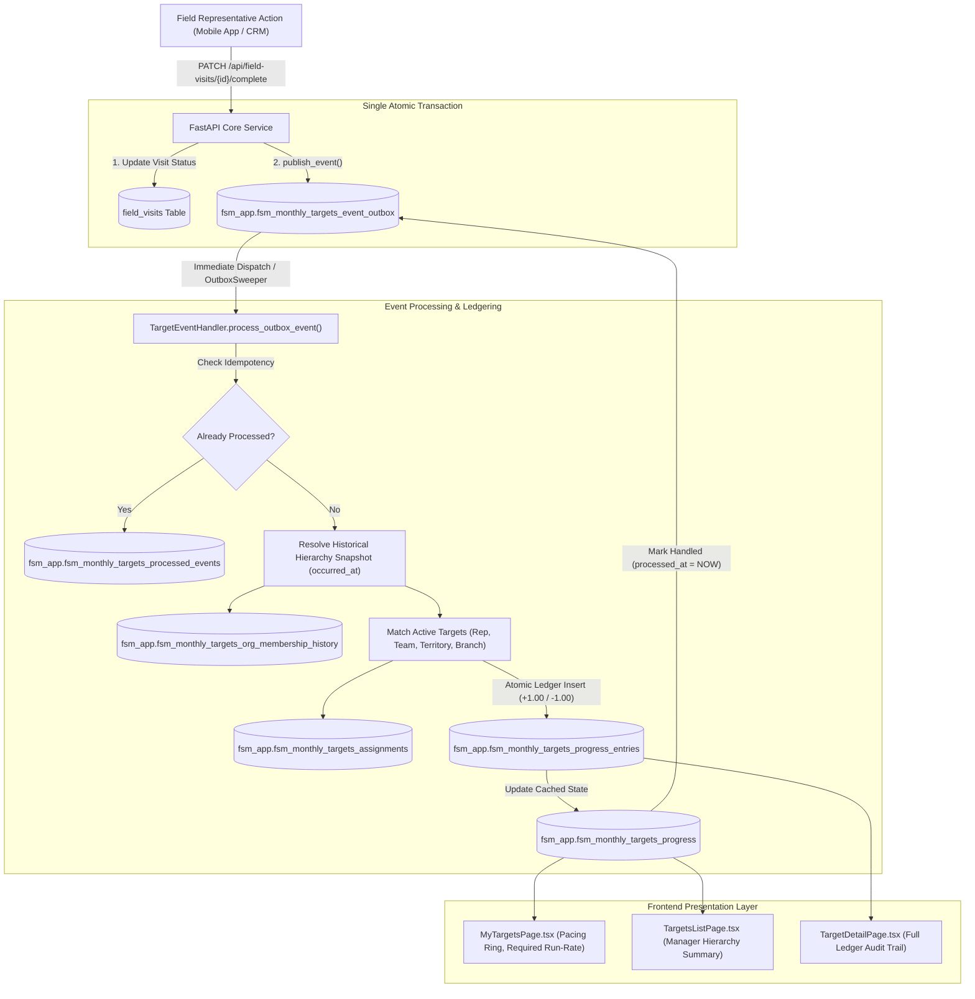

# FSM Core: Monthly Targets & Revenue Leakage Detection
## Complete Architecture, Data Flow, and Database Schema Guide

---

# 1. Architectural Foundations & Data Isolation

Both the **Monthly Targets** and **Revenue Leakage Detection** features are implemented in isolated PostgreSQL schemas to ensure multi-tenant security, separation of concerns, and compliance with enterprise security requirements.

### Schema Structure:
1. **`fsm_app` (Live Application Schema):**
   * Houses all active operational tables, transactional outbox queues, double-entry ledger entries, rules configuration, and active alerts.
   * **Security Isolation:** Direct client/PostgREST public access (`anon`, `authenticated`, `public`) is strictly revoked.
   * **Row-Level Security (RLS):** Enabled on every single table with no public policies.
   * **Access:** Only the dedicated backend application service user (`fsm_app_user`) has credentials to read/write in this schema.
2. **`fsm_archive` (Cold Archive Schema):**
   * Houses closed target ledger entries and historical resolved/dismissed alert chains older than the retention period.
   * Prevents transaction tables from growing unboundedly while preserving historical data for multi-year compliance audits.
3. **`fsm_app.holidays` (Shared Calendar Table):**
   * Shared business calendar listing national and regional holidays.
   * Used by both engines to calculate elapsed and remaining **working business days** (excluding weekends and official company holidays).

---

# 2. Feature 1: Monthly Target Management & Progress Ledger

## 2.1 Overview & Key Capabilities
* **Multi-Tier Goal Setting:** Quota allocation across 4 organizational levels:
  1. **Individual Representative (MR / Field Officer)**
  2. **Sales Team**
  3. **Territory**
  4. **Branch**
* **Supported Performance Metrics:**
  * `doctor_visits`: Verified field visits logged by medical representatives.
  * `new_leads`: Commercial customer leads generated in the CRM.
  * `conversions`: Leads successfully converted to active buying accounts.
  * `revenue`: Total booked sales order value (in INR).
  * `collections`: Cash and check payments collected from accounts (in INR).
* **Synchronized Target Fan-Out:** A single operational achievement (e.g., a medical representative completing a doctor visit) automatically advances the representative's personal target, their team's target, their territory's target, and their branch's target in one atomic transaction.
* **Point-in-Time Attribution:** Past target contributions remain attributed to the team and territory where the rep was located when the event occurred, even if the representative transfers to another territory mid-month.
* **Double-Entry Financial-Grade Progress Ledger:** Target progress is never maintained as an overwritten counter. Every increment, manual adjustment, or retraction is recorded as an immutable ledger row.
* **Reversals & Retractions:** When visits are cancelled, orders voided, or checks bounced, negative reversal ledger entries are automatically posted against the original targets.
* **Working-Day Run-Rate Pacing:** Converts timestamps to business dates, calculates remaining working days (stripping weekends and public holidays), and computes:
  $$\text{Required Daily Run-Rate} = \frac{\text{Target Value} - \text{Current Value}}{\text{Remaining Working Days}}$$
  $$\text{Projected Finish} = \text{Current Value} + (\text{Actual Run-Rate} \times \text{Remaining Working Days})$$

---

## 2.2 End-to-End Data Flow



### Detailed Lifecycle Steps:
1. **Event Publication:** When a rep marks a visit completed, `publish_event()` writes `VisitCompletedEvent` into `fsm_monthly_targets_event_outbox` inside the exact same database transaction that updates the visit.
2. **Immediate Inline Dispatch:** The endpoint immediately triggers `OutboxSweeper.process_single_row(db, event_id)`.
3. **Sweeper Fault-Tolerance:** If the inline call fails or the worker dies, a separate cron process runs `python -m app.features.monthly_target.jobs sweeper` every minute. It queries pending outbox rows older than 30s (`FOR UPDATE SKIP LOCKED`) and retries them with exponential backoff (2s, 4s, 8s... up to 900s). Rows failing after 10 retries are moved to `failed_events`.
4. **Idempotency & Historical Org Lookup:** The handler checks `processed_events`. It queries `org_membership_history` using `occurred_at` to resolve the rep's team, territory, and branch at the moment of visit execution.
5. **Atomic Ledger Recording:** The handler posts an immutable row to `progress_entries` for each matching target assignment and updates `progress.current_value`.
6. **Nightly Automated Reconciliation:** At 03:00 AM, `run_nightly_reconciliation` recomputes progress by re-summing all live ledger entries (`progress_entries`) plus any archived historical totals (`archived_totals`). Any drift is logged to `reconciliation_drifts` and auto-corrected.
7. **Target Closing & Archival:** Targets past `end_date + grace_days` are frozen and marked `closed` with `final_value`. Targets closed longer than retention months are moved into `fsm_archive.fsm_monthly_targets_progress_entries`.

---

## 2.3 Monthly Targets Database Schema

### Database Enums in `fsm_app`:
* `fsm_app.metric_type`: `'revenue'`, `'doctor_visits'`, `'new_leads'`, `'conversions'`, `'collections'`
* `fsm_app.entity_type`: `'representative'`, `'team'`, `'territory'`, `'branch'`, `'customer'`, `'product'`
* `fsm_app.target_status`: `'active'`, `'backfilling'`, `'closed'`, `'cancelled'`
* `fsm_app.entry_type`: `'contribution'`, `'reversal'`

---

### Table: `fsm_app.fsm_monthly_targets_targets`
Stores high-level target definitions and period boundaries.

| Column Name | Data Type | Constraints & Defaults | Description |
| :--- | :--- | :--- | :--- |
| `id` | UUID | PRIMARY KEY, default `gen_random_uuid()` | Unique Target ID |
| `title` | VARCHAR(255) | NOT NULL, CHECK `char_length(title) >= 3` | Target display title |
| `metric_type` | `fsm_app.metric_type` | NOT NULL | Metric tracked |
| `target_value` | NUMERIC(15,2) | NOT NULL, CHECK `target_value >= 0` | Target quota quantity/amount |
| `start_date` | DATE | NOT NULL | Start date of target period |
| `end_date` | DATE | NOT NULL, CHECK `end_date > start_date` | End date of target period |
| `status` | `fsm_app.target_status`| NOT NULL, DEFAULT `'active'` | Lifecycle status |
| `version` | INTEGER | NOT NULL, DEFAULT 1 | Optimistic concurrency version |
| `final_value` | NUMERIC(15,2) | NULL | Locked final progress when closed |
| `closed_at` | TIMESTAMPTZ | NULL | Timestamp target was closed |
| `adjusted_at` | TIMESTAMPTZ | NULL | Timestamp if updated after closing |
| `cancel_reason`| VARCHAR(500) | NULL | Reason for cancellation |
| `idempotency_key`| VARCHAR(100)| NULL | Caller idempotency key |
| `created_by` | UUID | NOT NULL | Employee UUID of creator |
| `created_at` | TIMESTAMPTZ | NOT NULL, DEFAULT `NOW()` | Creation timestamp |
| `updated_at` | TIMESTAMPTZ | NOT NULL, DEFAULT `NOW()` | Last update timestamp |
| `archived_at` | TIMESTAMPTZ | NULL | Timestamp moved to archive |

* **Indexes:**
  * `ix_targets_dates` ON `(start_date, end_date)`
  * `ix_targets_metric` ON `(metric_type)`
  * `ix_targets_status` ON `(status)`
  * `uq_targets_idempotency` UNIQUE ON `(created_by, idempotency_key) WHERE idempotency_key IS NOT NULL`

---

### Table: `fsm_app.fsm_monthly_targets_assignments`
Assigns portions of target quotas to specific entities in the hierarchy.

| Column Name | Data Type | Constraints & Defaults | Description |
| :--- | :--- | :--- | :--- |
| `id` | UUID | PRIMARY KEY, default `gen_random_uuid()` | Unique Assignment ID |
| `target_id` | UUID | NOT NULL, FK &rarr; `fsm_monthly_targets_targets(id)` ON DELETE RESTRICT | Target reference |
| `entity_type` | `fsm_app.entity_type` | NOT NULL | `representative`, `team`, `territory`, `branch` |
| `entity_id` | UUID | NOT NULL | UUID of employee, team, territory, or branch |
| `assigned_at` | TIMESTAMPTZ | NOT NULL, DEFAULT `NOW()` | Timestamp assignment was created |
| `ended_at` | TIMESTAMPTZ | NULL | Timestamp assignment was revoked/ended |

* **Constraints & Indexes:**
  * `uq_target_assignment` UNIQUE ON `(target_id, entity_type, entity_id)`
  * `ix_target_assignments_entity` ON `(entity_type, entity_id)`
  * `ix_target_assignments_target` ON `(target_id)`

---

### Table: `fsm_app.fsm_monthly_targets_progress`
Cached state summary table for fast UI dashboard queries (1:1 with assignment).

| Column Name | Data Type | Constraints & Defaults | Description |
| :--- | :--- | :--- | :--- |
| `id` | UUID | PRIMARY KEY, default `gen_random_uuid()` | Unique Progress ID |
| `assignment_id`| UUID | NOT NULL, UNIQUE, FK &rarr; `fsm_monthly_targets_assignments(id)` ON DELETE CASCADE | Associated assignment |
| `current_value`| NUMERIC(15,2) | NOT NULL, DEFAULT 0 | Real-time cached progress sum |
| `last_updated_at`| TIMESTAMPTZ| NOT NULL, DEFAULT `NOW()` | Timestamp of last ledger update |

---

### Table: `fsm_app.fsm_monthly_targets_progress_entries`
**The append-only financial-grade progress ledger.** Every credit or debit is an immutable fact.

| Column Name | Data Type | Constraints & Defaults | Description |
| :--- | :--- | :--- | :--- |
| `id` | UUID | PRIMARY KEY, default `gen_random_uuid()` | Unique Ledger Entry ID |
| `assignment_id`| UUID | NOT NULL, FK &rarr; `fsm_monthly_targets_assignments(id)` ON DELETE RESTRICT | Target assignment |
| `source_event_id`| UUID | NOT NULL | ID of originating domain event |
| `source_event_type`| VARCHAR(50)| NOT NULL | `visit_completed`, `order_closed`, etc. |
| `entry_type` | `fsm_app.entry_type`| NOT NULL | `'contribution'` or `'reversal'` |
| `delta` | NUMERIC(15,2) | NOT NULL | Positive for contribution, negative for reversal |
| `contributor_id`| UUID | NOT NULL | Rep UUID who performed the action |
| `occurred_at` | TIMESTAMPTZ | NOT NULL | Physical timestamp when event occurred |
| `business_date`| DATE | NOT NULL | Local business date of event |
| `excluded` | BOOLEAN | NOT NULL, DEFAULT FALSE | True if rejected by audit/reversal |
| `excluded_reason`| VARCHAR(100)| NULL | Justification for exclusion |
| `created_at` | TIMESTAMPTZ | NOT NULL, DEFAULT `NOW()` | Timestamp entry was written |

* **Constraints & Indexes:**
  * `uq_progress_entry` UNIQUE ON `(assignment_id, source_event_id, entry_type)`
  * `ck_progress_delta` CHECK `(entry_type = 'contribution' AND delta > 0) OR (entry_type = 'reversal' AND delta < 0)`
  * `ix_progress_entries_assignment_date` ON `(assignment_id, business_date)`
  * `ix_progress_entries_source_event` ON `(source_event_id)`

---

### Table: `fsm_app.fsm_monthly_targets_event_outbox`
Transactional message queue supporting the Transactional Outbox pattern.

| Column Name | Data Type | Constraints & Defaults | Description |
| :--- | :--- | :--- | :--- |
| `id` | UUID | PRIMARY KEY (Matches `event.event_id`) | Event UUID |
| `event_type` | VARCHAR(50) | NOT NULL | Event classification name |
| `event_version`| INTEGER | NOT NULL | Pydantic event version (currently 1) |
| `payload` | JSONB | NOT NULL | Full serialized event JSON |
| `created_at` | TIMESTAMPTZ | NOT NULL, DEFAULT `NOW()` | Publication timestamp |
| `processed_at`| TIMESTAMPTZ | NULL | NULL until successfully handled |
| `attempts` | INTEGER | NOT NULL, DEFAULT 0 | Number of dispatch attempts |
| `last_error` | TEXT | NULL | Stack trace/error message of last failure |

* **Indexes:**
  * `ix_outbox_unprocessed` ON `(created_at) WHERE processed_at IS NULL`

---

### Table: `fsm_app.fsm_monthly_targets_processed_events`
Deduplication table ensuring strict idempotency.

| Column Name | Data Type | Constraints & Defaults | Description |
| :--- | :--- | :--- | :--- |
| `event_id` | UUID | PRIMARY KEY | Original Event UUID |
| `event_type` | VARCHAR(50) | NOT NULL | Event classification name |
| `processed_at`| TIMESTAMPTZ | NOT NULL, DEFAULT `NOW()` | Timestamp first processed |

---

### Table: `fsm_app.fsm_monthly_targets_failed_events`
Dead-letter queue for events failing 10 consecutive retry attempts.

| Column Name | Data Type | Constraints & Defaults | Description |
| :--- | :--- | :--- | :--- |
| `id` | UUID | PRIMARY KEY, default `gen_random_uuid()` | Dead-letter record ID |
| `event_type` | VARCHAR(50) | NOT NULL | Event classification name |
| `event_version`| INTEGER | NOT NULL | Payload version |
| `payload` | JSONB | NOT NULL | Complete raw event payload |
| `reason` | VARCHAR(500) | NOT NULL | Root cause description |
| `created_at` | TIMESTAMPTZ | NOT NULL, DEFAULT `NOW()` | Insertion timestamp |
| `resolved_at` | TIMESTAMPTZ | NULL | Timestamp reviewed by engineers |

---

### Table: `fsm_app.fsm_monthly_targets_org_membership_history`
Point-in-time organizational structure supporting historical transfers.

| Column Name | Data Type | Constraints & Defaults | Description |
| :--- | :--- | :--- | :--- |
| `id` | UUID | PRIMARY KEY, default `gen_random_uuid()` | Record ID |
| `employee_id` | UUID | NOT NULL | Employee / MR UUID |
| `team_id` | UUID | NOT NULL | Assigned Team UUID |
| `territory_id`| UUID | NOT NULL | Assigned Territory UUID |
| `branch_id` | UUID | NOT NULL | Assigned Branch UUID |
| `effective_from`| TIMESTAMPTZ| NOT NULL | Start timestamp of assignment |
| `effective_to` | TIMESTAMPTZ| NULL | End timestamp (NULL if currently active) |

* **Constraints & Indexes:**
  * `ex_org_membership_overlap` EXCLUDE USING gist on `employee_id WITH =, tstzrange(effective_from, COALESCE(effective_to, 'infinity')) WITH &&`
  * `ix_org_membership_emp` ON `(employee_id)`

---

### Table: `fsm_app.fsm_monthly_targets_changes`
Audit log of all manual target value adjustments.

| Column Name | Data Type | Constraints & Defaults | Description |
| :--- | :--- | :--- | :--- |
| `id` | UUID | PRIMARY KEY, default `gen_random_uuid()` | Change log ID |
| `target_id` | UUID | NOT NULL, FK &rarr; `fsm_monthly_targets_targets(id)` ON DELETE RESTRICT | Target reference |
| `version` | INTEGER | NOT NULL | Target version at change |
| `field` | VARCHAR(50) | NOT NULL | Field modified (e.g. `target_value`) |
| `old_value` | TEXT | NULL | Previous value |
| `new_value` | TEXT | NULL | New value |
| `reason` | VARCHAR(500) | NOT NULL, min 5 chars | Mandatory business reason |
| `changed_by` | UUID | NOT NULL | Manager UUID |
| `changed_at` | TIMESTAMPTZ | NOT NULL, DEFAULT `NOW()` | Modification timestamp |

---

### Table: `fsm_app.fsm_monthly_targets_reconciliation_runs` & `_drifts`
Tracks nightly automated 03:00 AM ledger reconciliation and drift correction.

* **`reconciliation_runs`:** `id` (UUID PK), `started_at` (TIMESTAMPTZ), `finished_at` (TIMESTAMPTZ), `status` (VARCHAR: `running`, `succeeded`, `failed`), `targets_checked` (INT), `drifts_found` (INT).
* **`reconciliation_drifts`:** `id` (UUID PK), `run_id` (UUID FK), `assignment_id` (UUID FK), `stored_value` (NUMERIC 15,2), `recomputed_value` (NUMERIC 15,2), `source_value` (NUMERIC 15,2), `kind` (VARCHAR), `created_at` (TIMESTAMPTZ).

---

### Tables in `fsm_archive`:
* **`fsm_app.fsm_monthly_targets_archived_totals`:** Pre-aggregated sums (`assignment_id`, `entry_count`, `entry_sum`, `archived_at`) kept in `fsm_app` so reconciliation can sum live + archived ledger rows.
* **`fsm_archive.fsm_monthly_targets_progress_entries`:** Compressed ledger entries moved from `fsm_app` after targets have been closed or cancelled for $\ge$ `archive_after_months`.

---
---

# 3. Feature 2: Revenue Leakage Detection (Operational Warnings)

## 3.1 Overview & Key Capabilities
* **Autonomous Inactivity Radar:** Periodically scans operational databases to detect stalled commercial opportunities, abandoned leads, and neglected doctor accounts.
* **Non-Alarmist Compliance Language:** Strictly avoids misleading words like *"loss"*, *"leakage"*, or *"lost revenue"*. Findings are formally categorized as **Operational Warnings** with an **Exposure Amount** and objective explanation.
* **The 5 Detection Rules:**
  1. `unvisited_client`: High-value clients or hospitals with zero verified field visits within configured working days.
  2. `abandoned_lead`: Leads with no documented representative follow-up activity within threshold working days.
  3. `declining_frequency`: Established accounts whose order/visit frequency has dropped significantly below their historical baseline.
  4. `inactive_opportunity`: Deals in active pipeline stages stalled past expected sales velocity.
  5. `underperforming_territory`: Territories lagging significantly behind operational achievement benchmarks.
* **Mathematical Severity Scoring:** Severity is calculated using working-day threshold ratios:
  $$\text{Severity Ratio} = \frac{\text{Observed Inactive Working Days}}{\text{Threshold Days}}$$
  * $\text{Ratio} \ge \text{High Priority Ratio}$ &rarr; **High Priority**
  * $\text{Ratio} \ge \text{Medium Priority Ratio}$ &rarr; **Medium Priority**
  * $\text{Otherwise}$ &rarr; **Low Priority**
* **Manager Governance Actions:** Formal actions supported: **Acknowledge**, **Resolve** (with evidence), **Dismiss** (with cooldown), or **Add Note**.
* **Self-Healing & Auto-Clear:** If subsequent scans show an account has resumed regular visits and cleared conditions across consecutive scans (`autoclear_scans`, default 2), the alert is automatically resolved.
* **Suppressed Recurrence:** Dismissed alerts cannot trigger again until the cooldown window (`dismiss_days`, default 30 days) expires.
* **Auto-Escalation:** Active alerts unacknowledged past `escalation_days` automatically escalate to Level 1 and alert higher-level management.

---

## 3.2 End-to-End Data Flow

```mermaid
flowchart TD
    A[("Operational Source Data (field_visits, leads, orders, targets)")] -->|"Decoupled Read-Only Ports (ports.py)"| B["LeakageScanner Batch Process"]
    
    subgraph Scanner_Run ["Scanner Evaluation (Session Advisory Lock)"]
        B --> C["Rule Evaluators (rules/*.py)"]
        C --> D["WorkingCalendar (Working Days & Holiday Check)"]
        D --> E["PriorityCalculator (Threshold Ratios & Reason Text)"]
    end
    
    E --> F["AlertLifecycle Manager"]
    
    subgraph Lifecycle_Decision ["Lifecycle State Machine"]
        F --> G{Entity In Violation?}
        G -->|Yes & No Active Alert| H["Create Alert in fsm_revenue_leakage_alerts"]
        G -->|Yes & Active Alert Exists| I["Update last_observed_at, Record AlertObservation"]
        G -->|Yes & Dismissed (Cooldown)| J["Suppress Alert (Check suppressed_until)"]
        G -->|No & Alert Active| K["Increment clear_streak"]
        K --> L{clear_streak >= autoclear_scans?}
        L -->|Yes| M["Auto-Resolve Alert (outcome = condition_cleared)"]
        L -->|No| N["Wait Next Scan"]
    end
    
    subgraph Manager_Intervention ["Manager Governance"]
        H --> O["AlertsDashboardPage.tsx (Active Warnings Table)"]
        O --> P["AlertDetailPage.tsx (Timeline & Recurrence History)"]
        P -->|"POST /alerts/{id}/actions"| Q["AlertActionModal.tsx"]
        Q -->|"Acknowledge, Resolve with Evidence, Dismiss"| R[("fsm_app.fsm_revenue_leakage_alert_actions")]
    end
    
    subgraph Background_Workers ["Scheduled Background Workers"]
        S["Escalation Worker"] -->|"If unacknowledged >= escalation_days"| T["Set escalation_level = 1, Notify ZSM/GM"]
        U["Daily Digest Worker"] -->|"Morning Briefing"| V["Generate In-App / Email Digests for Managers"]
    end
```

### Detailed Lifecycle Steps:
1. **Batch Scan Trigger:** The scanner job (`python -m app.features.revenue_leakage.jobs scan`) runs off-peak under a PostgreSQL session advisory lock.
2. **Decoupled Data Fetching:** The scanner queries data through read-only adapters (`ports.py`): `visits`, `leads`, `orders`, and `targets`.
3. **Working-Day Rule Evaluation:** The rule engine calculates working days elapsed since last activity, stripping holidays from `fsm_app.holidays`.
4. **Alert Lifecycle & Upsert:**
   * **New Finding:** Inserts an alert into `fsm_app.fsm_revenue_leakage_alerts` and records an initial observation in `fsm_app.fsm_revenue_leakage_alert_observations`.
   * **Existing Finding:** Updates `last_observed_at`. If priority changed or values moved by more than `change_ratio` (10%), it inserts a new sensor observation row.
   * **Cleared Finding:** If an entity is healthy, `clear_streak` is incremented. When `clear_streak >= autoclear_scans`, the alert automatically flips to `status = 'resolved'` with `outcome = 'condition_cleared'`.
5. **Manager Action:**
   * Managers view warnings on `AlertsDashboardPage.tsx`.
   * Submitting an action (`acknowledge`, `resolve`, `dismiss`, `note`) performs an optimistic locking check (`expected_version`).
   * When resolving with commercial outcome evidenced, the system strictly enforces a mandatory proof reference (e.g., invoice number or CRM task ID).
6. **Escalation & Notification:**
   * Every evening, `run_escalation()` checks active unacknowledged alerts exceeding `escalation_days` working days, sets `escalation_level = 1`, and logs an automated action.
   * Every morning, `run_daily_digest()` dispatches summary digests to area managers.

---

## 3.3 Revenue Leakage Database Schema

### Database Enums in `fsm_app`:
* `fsm_app.rule_code`: `'unvisited_client'`, `'abandoned_lead'`, `'declining_frequency'`, `'inactive_opportunity'`, `'underperforming_territory'`
* `fsm_app.classification`: `'operational_warning'`, `'potential_exposure'`, `'confirmed_commercial_loss'`, `'verified_financial_discrepancy'` (Production generates `operational_warning`)
* `fsm_app.attention_priority`: `'low'`, `'medium'`, `'high'`
* `fsm_app.alert_status`: `'active'`, `'acknowledged'`, `'resolved'`, `'dismissed'`
* `fsm_app.action_type`: `'acknowledged'`, `'resolved'`, `'dismissed'`, `'note'`, `'escalated'`, `'auto_cleared'`
* `fsm_app.outcome`: `'normal_variation'`, `'investigation_needed'`, `'corrective_action_taken'`, `'commercial_outcome_evidenced'`, `'condition_cleared'`
* `fsm_app.observation_reason`: `'created'`, `'priority_changed'`, `'value_changed'`, `'resolved'`, `'suppressed_recurrence'`
* `fsm_app.scan_status`: `'running'`, `'succeeded'`, `'failed'`, `'partial'`, `'skipped_source_missing'`
* `fsm_app.scan_mode`: `'baseline'`, `'normal'`
* `fsm_app.notification_kind`: `'created'`, `'priority_raised'`, `'escalated'`

---

### Table: `fsm_app.fsm_revenue_leakage_rules`
Stores the configuration, thresholds, and ratios for the 5 detection rules.

| Column Name | Data Type | Constraints & Defaults | Description |
| :--- | :--- | :--- | :--- |
| `id` | UUID | PRIMARY KEY, default `gen_random_uuid()` | Unique Rule ID |
| `rule_code` | `fsm_app.rule_code` | NOT NULL, UNIQUE | Rule identifier |
| `rule_name` | VARCHAR(255) | NOT NULL | Human-readable rule title |
| `description` | VARCHAR(500) | NULL | Rule purpose and criteria |
| `threshold_days`| INTEGER | NOT NULL, DEFAULT 30, CHECK $\ge 1$ | Inactivity threshold in working days |
| `threshold_value`| NUMERIC(15,2)| NOT NULL, DEFAULT 0, CHECK $\ge 0$ | Baseline value threshold |
| `medium_priority_ratio`| NUMERIC(5,2)| NOT NULL, DEFAULT 1.50, CHECK $\ge 1.0$ | Medium priority ratio multiplier |
| `high_priority_ratio`| NUMERIC(5,2)| NOT NULL, DEFAULT 2.00, CHECK $>$ medium | High priority ratio multiplier |
| `change_ratio` | NUMERIC(5,2) | NOT NULL, DEFAULT 0.10, CHECK $>0$ and $\le 1.0$ | Shift needed to log observation (10%) |
| `cooldown_days`| INTEGER | NOT NULL, DEFAULT 7, CHECK $\ge 0$ | Minimum days between recurrence |
| `dismiss_days` | INTEGER | NOT NULL, DEFAULT 30, CHECK $\ge 0$ | Suppression window when dismissed |
| `autoclear_scans`| INTEGER | NOT NULL, DEFAULT 2, CHECK $\ge 1$ | Consecutive clean scans to auto-resolve |
| `escalation_days`| INTEGER | NOT NULL, DEFAULT 3, CHECK $\ge 1$ | Working days unacknowledged before escalation |
| `min_history_months`| INTEGER | NOT NULL, DEFAULT 3, CHECK $\ge 1$ | Historical data lookback window |
| `params` | JSONB | NOT NULL, DEFAULT `'{}'` | Rule-specific configuration parameters |
| `required_sources`| TEXT[] | NOT NULL, DEFAULT `'{}'` | Required data sources (e.g. `visits`, `orders`) |
| `is_active` | BOOLEAN | NOT NULL, DEFAULT TRUE | Active toggle |
| `created_at` | TIMESTAMPTZ | NOT NULL, DEFAULT `NOW()` | Creation timestamp |
| `updated_at` | TIMESTAMPTZ | NOT NULL, DEFAULT `NOW()` | Last modified timestamp |

---

### Table: `fsm_app.fsm_revenue_leakage_rule_changes`
Mandatory audit log tracking all modifications to rule thresholds or ratios.

| Column Name | Data Type | Constraints & Defaults | Description |
| :--- | :--- | :--- | :--- |
| `id` | UUID | PRIMARY KEY, default `gen_random_uuid()` | Audit record ID |
| `rule_id` | UUID | NOT NULL, FK &rarr; `fsm_revenue_leakage_rules(id)` | Rule reference |
| `field` | VARCHAR(50) | NOT NULL | Modified field (e.g. `threshold_days`) |
| `old_value` | TEXT | NULL | Value before modification |
| `new_value` | TEXT | NULL | Value after modification |
| `reason` | VARCHAR(500) | NOT NULL, CHECK `char_length(reason) >= 5` | Mandatory change justification |
| `changed_by` | UUID | NOT NULL | Senior Manager UUID |
| `changed_at` | TIMESTAMPTZ | NOT NULL, DEFAULT `NOW()` | Modification timestamp |

* **Indexes:** `ix_rule_changes_rule_time` ON `(rule_id, changed_at DESC)`

---

### Table: `fsm_app.fsm_revenue_leakage_alerts`
**Primary table storing active and historical operational warnings.**

| Column Name | Data Type | Constraints & Defaults | Description |
| :--- | :--- | :--- | :--- |
| `id` | UUID | PRIMARY KEY, default `gen_random_uuid()` | Alert UUID |
| `rule_id` | UUID | NOT NULL, FK &rarr; `fsm_revenue_leakage_rules(id)` | Rule reference |
| `entity_type` | VARCHAR(50) | NOT NULL, CHECK in (`'customer'`, `'lead'`, `'territory'`) | Entity classification |
| `entity_id` | UUID | NOT NULL | UUID of customer, lead, or territory |
| `classification`| `fsm_app.classification`| NOT NULL, DEFAULT `'operational_warning'` | Classification tier |
| `attention_priority`| `fsm_app.attention_priority`| NOT NULL | `'low'`, `'medium'`, `'high'` |
| `priority_reason`| VARCHAR(500)| NOT NULL | Plain-language reason for severity score |
| `observation` | JSONB | NOT NULL | Snapshot of metrics at detection |
| `exposure_amount`| NUMERIC(15,2)| NULL | Estimated commercial exposure |
| `exposure_basis`| VARCHAR(500)| NULL | Transparent formula explanation |
| `status` | `fsm_app.alert_status`| NOT NULL, DEFAULT `'active'` | `'active'`, `'acknowledged'`, `'resolved'`, `'dismissed'` |
| `version` | INTEGER | NOT NULL, DEFAULT 1 | Optimistic concurrency version |
| `occurrence_no`| INTEGER | NOT NULL, DEFAULT 1 | Recurrence count for this entity |
| `previous_alert_id`| UUID | NULL | Previous resolved alert ID in chain |
| `first_detected_at`| TIMESTAMPTZ| NOT NULL, DEFAULT `NOW()` | Timestamp first triggered |
| `last_observed_at`| TIMESTAMPTZ| NOT NULL, DEFAULT `NOW()` | Timestamp last verified by scanner |
| `last_notified_at`| TIMESTAMPTZ| NULL | Timestamp last dispatched in notification |
| `clear_streak` | INTEGER | NOT NULL, DEFAULT 0 | Count of consecutive healthy scans |
| `suppressed_until`| TIMESTAMPTZ| NULL | Cooldown expiration date |
| `escalation_level`| INTEGER | NOT NULL, DEFAULT 0 | 0 = normal, 1 = escalated to leadership |
| `escalated_at` | TIMESTAMPTZ | NULL | Timestamp escalated |
| `resolved_at` | TIMESTAMPTZ | NULL | Timestamp resolved |

* **Constraints & Indexes:**
  * **Partial Unique Index:** `uq_active_leakage_alert` UNIQUE ON `(rule_id, entity_type, entity_id) WHERE status IN ('active', 'acknowledged')` *(Ensures an entity cannot have duplicate open alerts)*.
  * `ck_exposure_basis` CHECK: `exposure_amount` and `exposure_basis` must either both be NULL or both be NOT NULL.
  * `ix_leakage_alerts_status_prio` ON `(status, attention_priority)`
  * `ix_leakage_alerts_entity` ON `(entity_type, entity_id)`

---

### Table: `fsm_app.fsm_revenue_leakage_alert_observations`
Time-series sensor observations capturing metric shifts during scanner sweeps.

| Column Name | Data Type | Constraints & Defaults | Description |
| :--- | :--- | :--- | :--- |
| `id` | UUID | PRIMARY KEY, default `gen_random_uuid()` | Observation ID |
| `alert_id` | UUID | NOT NULL, FK &rarr; `fsm_revenue_leakage_alerts(id)` ON DELETE CASCADE | Associated alert |
| `observed_at` | TIMESTAMPTZ | NOT NULL, DEFAULT `NOW()` | Sweep timestamp |
| `observation` | JSONB | NOT NULL | Exact metric payload observed |
| `attention_priority`| `fsm_app.attention_priority`| NOT NULL | Priority at time of observation |
| `reason` | `fsm_app.observation_reason`| NOT NULL | `'created'`, `'priority_changed'`, `'value_changed'`, `'resolved'`, etc. |

* **Indexes:** `ix_alert_obs_alert_time` ON `(alert_id, observed_at)`

---

### Table: `fsm_app.fsm_revenue_leakage_alert_actions`
Audit log of all manager and system interventions.

| Column Name | Data Type | Constraints & Defaults | Description |
| :--- | :--- | :--- | :--- |
| `id` | UUID | PRIMARY KEY, default `gen_random_uuid()` | Action record ID |
| `alert_id` | UUID | NOT NULL, FK &rarr; `fsm_revenue_leakage_alerts(id)` ON DELETE RESTRICT | Associated alert |
| `action_type` | `fsm_app.action_type`| NOT NULL | `'acknowledged'`, `'resolved'`, `'dismissed'`, `'note'`, `'escalated'`, `'auto_cleared'` |
| `outcome` | `fsm_app.outcome`| NULL | Required if resolved or dismissed |
| `action_taken`| VARCHAR(255)| NOT NULL, min 5 chars | Description of intervention |
| `evidence_reference`| VARCHAR(255)| NULL | Invoice #, CRM task ID, or proof link |
| `notes` | VARCHAR(1000)| NULL | Contextual notes |
| `action_by` | UUID | NOT NULL | Manager UUID or system worker UUID |
| `idempotency_key`| VARCHAR(100)| NULL | Client request idempotency key |
| `created_at` | TIMESTAMPTZ | NOT NULL, DEFAULT `NOW()` | Timestamp action was taken |

* **Constraints & Indexes:**
  * `uq_alert_action_idemp` UNIQUE ON `(alert_id, idempotency_key) WHERE idempotency_key IS NOT NULL`
  * `ck_action_outcome` CHECK: `outcome` is required when `action_type` is `'resolved'` or `'dismissed'`.
  * `ck_action_evidence` CHECK: `evidence_reference` is required when `outcome` is `'commercial_outcome_evidenced'`.
  * `ix_alert_actions_alert_created` ON `(alert_id, created_at)`

---

### Table: `fsm_app.fsm_revenue_leakage_alert_chains`
Tracks recurring alerts across historical archive boundaries to preserve recurrence counts.

| Column Name | Data Type | Constraints & Defaults | Description |
| :--- | :--- | :--- | :--- |
| `rule_id` | UUID | NOT NULL, FK &rarr; `fsm_revenue_leakage_rules(id)` | Rule reference |
| `entity_type` | VARCHAR(50) | NOT NULL | Entity classification |
| `entity_id` | UUID | NOT NULL | Customer, lead, or territory UUID |
| `last_alert_id`| UUID | NOT NULL | ID of most recent alert |
| `last_occurrence_no`| INTEGER | NOT NULL, DEFAULT 1 | Total historical occurrences |
| `last_closed_at`| TIMESTAMPTZ| NULL | Timestamp last alert resolved/dismissed |
| `suppressed_until`| TIMESTAMPTZ| NULL | Cooldown expiration |
| `updated_at` | TIMESTAMPTZ | NOT NULL, DEFAULT `NOW()` | Record update timestamp |

* **Primary Key:** `PRIMARY KEY (rule_id, entity_type, entity_id)`

---

### Table: `fsm_app.fsm_revenue_leakage_scan_runs`
Execution logs of scanner sweeps.

| Column Name | Data Type | Constraints & Defaults | Description |
| :--- | :--- | :--- | :--- |
| `id` | UUID | PRIMARY KEY, default `gen_random_uuid()` | Execution batch ID |
| `rule_code` | `fsm_app.rule_code` | NOT NULL | Rule evaluated |
| `mode` | `fsm_app.scan_mode` | NOT NULL, DEFAULT `'normal'` | `'baseline'` or `'normal'` |
| `started_at` | TIMESTAMPTZ | NOT NULL, DEFAULT `NOW()` | Execution start time |
| `heartbeat_at`| TIMESTAMPTZ | NOT NULL, DEFAULT `NOW()` | Liveness heartbeat |
| `finished_at`| TIMESTAMPTZ | NULL | Execution completion time |
| `status` | `fsm_app.scan_status`| NOT NULL, DEFAULT `'running'`| `'running'`, `'succeeded'`, `'failed'`, `'partial'` |
| `rows_evaluated`| INTEGER | NOT NULL, DEFAULT 0 | Count of records checked |
| `alerts_created`| INTEGER | NOT NULL, DEFAULT 0 | Count of new warnings created |
| `alerts_updated`| INTEGER | NOT NULL, DEFAULT 0 | Count of existing warnings updated |
| `alerts_cleared`| INTEGER | NOT NULL, DEFAULT 0 | Count of warnings auto-cleared |
| `attempt` | INTEGER | NOT NULL, DEFAULT 1 | Run attempt number |
| `error_message`| VARCHAR(1000)| NULL | Failure stack trace |

* **Indexes:** `ix_scan_runs_rule_started` ON `(rule_code, started_at DESC)`

---

### Table: `fsm_app.fsm_revenue_leakage_alert_notifications`
Outgoing notification queue for immediate alerts and daily morning digests.

| Column Name | Data Type | Constraints & Defaults | Description |
| :--- | :--- | :--- | :--- |
| `id` | UUID | PRIMARY KEY, default `gen_random_uuid()` | Notification queue ID |
| `alert_id` | UUID | NOT NULL, FK &rarr; `fsm_revenue_leakage_alerts(id)` ON DELETE CASCADE | Associated warning |
| `recipient_id`| UUID | NOT NULL | Recipient Manager UUID |
| `kind` | `fsm_app.notification_kind`| NOT NULL | `'created'`, `'priority_raised'`, `'escalated'` |
| `attention_priority`| `fsm_app.attention_priority`| NOT NULL | Priority at dispatch |
| `status` | VARCHAR(20) | NOT NULL, DEFAULT `'pending'`, CHECK in (`'pending'`, `'sent'`) | Delivery status |
| `digest_date` | DATE | NULL | Date aggregated in morning digest |
| `created_at` | TIMESTAMPTZ | NOT NULL, DEFAULT `NOW()` | Queue insertion timestamp |
| `sent_at` | TIMESTAMPTZ | NULL | Actual dispatch timestamp |

* **Indexes:** `ix_alert_notifications_pending` ON `(status, created_at) WHERE status = 'pending'`

---

### Table: `fsm_app.fsm_revenue_leakage_alert_views`
Access audit log tracking who viewed or exported warning details (Critic Gap P-10).

| Column Name | Data Type | Constraints & Defaults | Description |
| :--- | :--- | :--- | :--- |
| `id` | UUID | PRIMARY KEY, default `gen_random_uuid()` | View log ID |
| `alert_id` | UUID | NOT NULL, FK &rarr; `fsm_revenue_leakage_alerts(id)` ON DELETE CASCADE | Warning viewed |
| `viewer_id` | UUID | NOT NULL | Viewing user UUID |
| `action` | VARCHAR(20) | NOT NULL, DEFAULT `'view'`, CHECK in (`'view'`, `'export'`) | View action |
| `viewed_at` | TIMESTAMPTZ | NOT NULL, DEFAULT `NOW()` | Access timestamp |

* **Indexes:** `ix_alert_views_alert` ON `(alert_id, viewed_at)`

---

### Table: `fsm_app.fsm_revenue_leakage_source_availability`
Source availability health tracker. If an external operational source (e.g. `visits` or `orders`) is temporarily offline or undergoing maintenance, the scanner skips that rule to prevent generating false alerts.

| Column Name | Data Type | Constraints & Defaults | Description |
| :--- | :--- | :--- | :--- |
| `source_key` | VARCHAR(50) | PRIMARY KEY | Source identifier (`visits`, `orders`, `leads`, `targets`, `leave`, `sync`) |
| `is_available`| BOOLEAN | NOT NULL, DEFAULT TRUE | Liveness status |
| `checked_at` | TIMESTAMPTZ | NOT NULL, DEFAULT `NOW()` | Verification timestamp |
| `note` | VARCHAR(500) | NULL | Diagnostic notes |

---

### Tables in `fsm_archive`:
* **`fsm_archive.fsm_revenue_leakage_alerts`:** Preserves cold-archived alert records moved out of `fsm_app` after resolution.
* **`fsm_archive.fsm_revenue_leakage_alert_actions`:** Preserves cold-archived managerial audit logs.
* **`fsm_archive.fsm_revenue_leakage_alert_observations`:** Preserves cold-archived sensor observation history.
* **`fsm_archive.fsm_revenue_leakage_alert_views`:** Preserves access audit logs.

---
---

# 4. Frontend User Interface Architecture

Both features are integrated into the React/Vite single-page application under `frontend/src/features/`:

```
frontend/src/features/
├── monthly_target/
│   ├── api/
│   │   └── targetsApi.ts              # API calls & React hooks for targets, progress, holidays
│   ├── components/
│   │   ├── CreateTargetModal.tsx      # Quota wizard across rep, team, territory, branch
│   │   ├── EditTargetModal.tsx        # Threshold adjustment modal with mandatory reason
│   │   ├── CancelTargetModal.tsx      # Target cancellation confirmation with audit log
│   │   ├── ManageHolidaysModal.tsx    # Working calendar public holiday management
│   │   └── TargetCard.tsx             # Radial pacing meters, status badges, run-rate cards
│   ├── pages/
│   │   ├── MyTargetsPage.tsx          # Mobile view for reps (pacing ring, required run-rate)
│   │   ├── TargetsListPage.tsx        # Manager view (hierarchy summaries, filter toolbar)
│   │   └── TargetDetailPage.tsx       # Breakdown tab, audit ledger, and version history
│   └── types.ts                       # TypeScript DTOs mirroring backend Pydantic models
│
└── revenue_leakage/
    ├── api/
    │   └── revenueLeakageApi.ts       # API calls for warnings, actions, rules, and scan runs
    ├── components/
    │   ├── AlertActionModal.tsx       # Optimistic-locking action form (Acknowledge, Resolve, Dismiss)
    │   └── EditRuleModal.tsx          # Rule tuning dialog with mandatory reason audit
    ├── pages/
    │   ├── AlertsDashboardPage.tsx    # Prioritized operational warning grid & summary KPIs
    │   ├── AlertDetailPage.tsx        # Observation timeline, recurrence history, action log
    │   ├── RulesConfigPage.tsx        # 5-rule configuration matrix (thresholds, ratios)
    │   └── ScanRunsPage.tsx           # Scanner execution health and rows evaluated monitor
    └── types.ts                       # TypeScript DTOs mirroring backend Pydantic schemas
```

---

# 5. Production Operations & Scheduled Worker Commands

Per enterprise architecture constraint **P-3**, background jobs run as dedicated worker processes or external crons, **never inside the Uvicorn/FastAPI API process**.

### 5.1 Monthly Target Jobs CLI
```bash
# 1. Run outbox sweeper (Processes pending events; run every 1 minute via Cron / Task Scheduler)
python -m app.features.monthly_target.jobs sweeper

# 2. Run target closing job (Locks targets past end_date + grace_days; run nightly at 00:05)
python -m app.features.monthly_target.jobs closing

# 3. Run nightly reconciliation (Re-sums live ledger & repairs drift; run nightly at 03:00)
python -m app.features.monthly_target.jobs reconcile

# 4. Run archival job (Moves closed targets older than retention threshold to fsm_archive; run monthly)
python -m app.features.monthly_target.jobs archive
```

### 5.2 Revenue Leakage Jobs CLI
```bash
# 1. Run operational scanner sweep (Audits operational records; run nightly at 01:00)
python -m app.features.revenue_leakage.jobs scan

# 2. Run daily digest dispatcher (Sends morning briefing to managers; run daily at 07:30)
python -m app.features.revenue_leakage.jobs digest

# 3. Run escalation worker (Escalates unacknowledged alerts >= escalation_days; run daily at 18:00)
python -m app.features.revenue_leakage.jobs escalate
```

### 5.3 Crontab Configuration Example (`/etc/cron.d/fsm_workers`)
```bash
# Sweeper runs every minute
* * * * * root cd /app/backend && python -m app.features.monthly_target.jobs sweeper >> /var/log/fsm_sweeper.log 2>&1

# Nightly target closing at 00:05
5 0 * * * root cd /app/backend && python -m app.features.monthly_target.jobs closing >> /var/log/fsm_closing.log 2>&1

# Nightly scanner sweep at 01:00
0 1 * * * root cd /app/backend && python -m app.features.revenue_leakage.jobs scan >> /var/log/fsm_scanner.log 2>&1

# Nightly reconciliation at 03:00
0 3 * * * root cd /app/backend && python -m app.features.monthly_target.jobs reconcile >> /var/log/fsm_reconcile.log 2>&1

# Morning digest at 07:30
30 7 * * * root cd /app/backend && python -m app.features.revenue_leakage.jobs digest >> /var/log/fsm_digest.log 2>&1

# Evening escalation check at 18:00
0 18 * * * root cd /app/backend && python -m app.features.revenue_leakage.jobs escalate >> /var/log/fsm_escalate.log 2>&1
```

