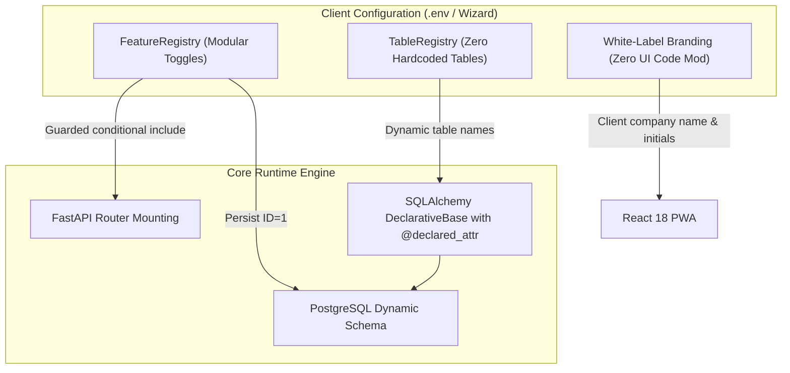

# Core FSM Engineering Data Report: Architecture & Data Specifications
**Prepared for Leadership & Engineering Alignment**  
**Companion Document to**: [`SHARED_ENGINEERING_DATA_REPORT.md`](file:///c:/Users/harin/Downloads/fsm/docs/architecture/SHARED_ENGINEERING_DATA_REPORT.md)

---

## 1. Master 4×4 Core FSM Engineering Data Matrix

| Layer | 1. Field Reps / MRs *(Execution)* | 2. Field Managers / RSMs & ZSMs *(Supervision)* | 3. Finance & HR Officers *(Ledgers & Compliance)* | 4. Executive Leadership & Admins *(Governance & Strategy)* |
| :--- | :--- | :--- | :--- | :--- |
| **Functionality**<br>*(What features they need)* | • GPS Geofenced Day Punch-In / Punch-Out<br>• Camera-only selfie proof for attendance verification<br>• Real-time break logging (lunch / tea breaks)<br>• Daily travel session tracking & accumulated distance<br>• Scheduled visit route execution & Doctor/Clinic DCR<br>• Extensible multi-vertical detailing (custom checklists)<br>• Leave application submission & quota balance view<br>• Active task inbox & status updates (`IN_PROGRESS` / `COMPLETED`) | • Team hierarchy visibility & subordinate org chart<br>• Downward reporting chain access control<br>• Team attendance review & geofence flag inspection<br>• Team visit logs & DCR performance tracking<br>• Concurrency-safe Leave approvals / rejections<br>• Direct task creation & delegation to subordinates<br>• High-value expense escalation reviews (>₹5,000) | • Office geofence coordinates & radius configuration<br>• Annual leave balance allocation & quota resets<br>• Overdue task & compliance audit reporting<br>• Expense verification & bank disbursement tagging<br>• Immutable system audit log inspection<br>• Workforce directory & territory code maintenance | • Multi-client Setup Wizard with vertical presets<br>• Dynamic feature toggle provisioning (runtime sync)<br>• Executive Analytics: completed calls vs expense burn<br>• Zonal performance leaderboard & achievement tiers<br>• Commercial lead conversion funnel tracking<br>• National workforce strike rate computation |
| **UI/UX**<br>*(What their interface looks like)* | • Mobile PWA first (Android / iOS thumb-friendly)<br>• High-contrast "Clock In / Clock Out" card<br>• Live GPS accuracy badge with location pill<br>• Fast visit cards with "Start Visit" & "Complete DCR"<br>• Camera modal with live capture & Base64 preview<br>• Personal leave balance chip ({N} days remaining) | • Desktop & Tablet responsive Management Portal<br>• Multi-level collapsible tree org chart<br>• Pending approval queues with 1-click action buttons<br>• Downline employee filter dropdown<br>• Modal dialog for leave rejection reasons<br>• Real-time task assignment bottom sheet | • High-density data grid & table layout<br>• Spatial map with circular office geofence overlays<br>• Quota ledger editor with inline number steppers<br>• Searchable audit log with actor ID & timestamp<br>• Clean export buttons for ledger statements | • Executive Dark/Modern hybrid analytics viewport<br>• Dual-axis chart: Completed Calls vs Expense Burn<br>• 5-Stage visual funnel chart with drop-off rates<br>• Zonal leaderboard with colored status chips<br>• Client Setup Wizard modal with instant preset cards |
| **Application Logic**<br>*(What logic supports them)* | • Spatial geofence check (Haversine & PostGIS)<br>• Anti-spoofing accuracy threshold check (&le;100m)<br>• Anti-spoofing velocity plausibility (&le;140 km/h)<br>• Automated working minutes calculation<br>• Cumulative session distance computation (`km`)<br>• Visit state machine (`SCHEDULED` &rarr; `IN_PROGRESS` &rarr; `COMPLETED`) | • Recursive SQL CTEs (`WITH RECURSIVE subordinate_tree`)<br>• Downward boundary isolation (zero lateral leakage)<br>• Row-level lock (`SELECT ... FOR UPDATE`) on leave balances<br>• Atomic balance deduction & attendance `ON_LEAVE` sync<br>• Downward task assignment permission guards | • Office boundary point-in-polygon / distance verification<br>• Atomic leave balance provisioning & initialization<br>• Audit trail generation for all managerial mutations<br>• Payment reference ID stamping on disbursements<br>• Dynamic table resolution via `TableRegistry` | • In-memory `FeatureRegistry` runtime updates<br>• Persistent synchronization with PostgreSQL `system_config`<br>• Pre-aggregated summary queries for sub-second KPIs<br>• Zonal strike rate engine (`calls / target * 100`)<br>• White-label dynamic branding injection (`branding.ts`) |
| **Data Schema**<br>*(What data they access or manage)* | **Access**: Own profile, assigned territory, today's attendance, scheduled visits, leave balances, assigned tasks.<br><br>**Manage**: Clock-in/out timestamps, selfie photos, break durations, visit DCR notes, custom fields, leave requests. | **Access**: Subordinate profiles, downline attendance, team visit logs, pending leave requests, team tasks.<br><br>**Manage**: Leave decisions (`APPROVED` / `REJECTED`), delegated task records, manager review notes. | **Access**: Company-wide employee directory, office locations, leave ledgers, full audit log.<br><br>**Manage**: Office coordinates & radii, annual leave quota allocations, disbursement transaction IDs. | **Access**: System-wide performance summaries, executive KPI aggregates, active feature configuration.<br><br>**Manage**: Active feature toggles, client presets, white-label branding configurations. |

---

## 2. Granular Core FSM Entity Data Profiles

### 2.1 Attendance & Geofencing Data Profile
* **System Entities**: `Attendance`, `OfficeLocation`, `BreakRecord`
* **Primary Key**: `id` (`UUIDv4`)
* **Dynamic Table Mappings**: `TABLE_ATTENDANCE`, `TABLE_OFFICE_LOCATIONS`, `TABLE_BREAKS`
* **Key Attributes**:
  * `employee_id`: UUID (Foreign Key &rarr; `employees.id`, ON DELETE CASCADE)
  * `work_date`: Date (Indexed)
  * `punch_in_time` / `punch_out_time`: Timestamp with Timezone
  * `punch_in_lat` / `punch_in_lon` / `punch_out_lat` / `punch_out_lon`: Double Precision Float
  * `punch_in_proof`: Text (Base64-encoded selfie photo proof)
  * `punch_out_summary`: Text (End-of-day summary notes)
  * `status`: Enum (`PRESENT`, `HALF_DAY`, `ABSENT`, `ON_LEAVE`)
  * `verification_status`: Enum (`VERIFIED`, `GEOFENCE_FLAGGED`, `ACCURACY_DEGRADED`, `MANUAL_OVERRIDE`)
  * `working_minutes`: Integer (Net active minutes excluding breaks)
* **Office Boundary Attributes (`OfficeLocation`)**:
  * `name`: String(100) (e.g., "Corporate Headquarters", "Mumbai Branch")
  * `latitude` / `longitude`: Double Precision Float
  * `radius_meters`: Integer (Default: 150m)
  * `is_active`: Boolean
* **Core APIs**:
  * `POST /api/attendance/clock-in` (GPS coords + Base64 proof)
  * `POST /api/attendance/clock-out` (GPS coords + summary)
  * `GET /api/attendance/today` (Current session status)
  * `POST /api/breaks/start` & `POST /api/breaks/end`

---

### 2.2 Field Travel & Client Detailing Data Profile
* **System Entities**: `FieldVisit`, `FieldSession`
* **Primary Key**: `id` (`UUIDv4`)
* **Dynamic Table Mappings**: `TABLE_FIELD_VISITS`, `TABLE_FIELD_SESSIONS`
* **Key Attributes**:
  * `session_id`: UUID (Foreign Key &rarr; `field_sessions.id`, ON DELETE SET NULL)
  * `employee_id`: UUID (Foreign Key &rarr; `employees.id`, ON DELETE CASCADE)
  * `target_type`: String(50) (`DOCTOR`, `CHEMIST`, `FARMER`, `PLANT`, `DEALER`)
  * `target_name`: String(200) (e.g., "Dr. Jane Smith (Cardiology)")
  * `target_identifier`: String(100) (e.g., Doctor Reg ID, Facility Code)
  * `visit_date`: Date (Indexed)
  * `arrival_time` / `completion_time`: Timestamp with Timezone
  * `latitude` / `longitude`: Double Precision Float
  * `proof_photo`: Text (Base64 check-in photo)
  * `discussion_notes`: Text (Daily Call Report detailing notes)
  * `custom_fields`: JSONB (Extensible checklists, sample kits, equipment metrics)
  * `status`: Enum (`SCHEDULED`, `IN_PROGRESS`, `COMPLETED`, `MISSED`, `CANCELLED`)
* **Travel Session Attributes (`FieldSession`)**:
  * `start_time` / `end_time`: Timestamp with Timezone
  * `start_lat`, `start_lon`, `end_lat`, `end_lon`: Double Precision Float
  * `accumulated_distance_km`: Float (Feeds downstream fuel mileage verification)
  * `status`: Enum (`ACTIVE`, `COMPLETED`)
* **Core APIs**:
  * `GET /api/field-visits?visit_date=YYYY-MM-DD`
  * `POST /api/field-visits` (Schedule visit)
  * `PATCH /api/field-visits/{id}/start` (Check-in with GPS + Photo)
  * `PATCH /api/field-visits/{id}/complete` (Submit DCR notes)
  * `POST /api/field-sessions/start` & `POST /api/field-sessions/end`

---

### 2.3 Leave & Balance Ledger Data Profile
* **System Entities**: `LeaveRequest`, `LeaveBalance`
* **Primary Key**: `id` (`UUIDv4`)
* **Dynamic Table Mappings**: `TABLE_LEAVE_REQUESTS`, `TABLE_LEAVE_BALANCES`
* **Key Attributes**:
  * `employee_id`: UUID (Foreign Key &rarr; `employees.id`, ON DELETE CASCADE)
  * `leave_type`: String(50) (`CASUAL`, `SICK`, `EARNED`, `UNPAID`)
  * `start_date` / `end_date`: Date
  * `days_count`: Float (Supports half-day deductions, e.g., 0.5, 1.0, 3.0)
  * `reason`: Text
  * `status`: Enum (`PENDING`, `APPROVED`, `REJECTED`, `CANCELLED`)
  * `approved_by_id`: UUID (Foreign Key &rarr; `employees.id`, ON DELETE SET NULL)
  * `approved_at`: Timestamp with Timezone
  * `rejection_reason`: Text (Nullable)
* **Balance Ledger Attributes (`LeaveBalance`)**:
  * `year`: Integer (e.g., 2026)
  * `allocated_days`: Float (Annual entitlement)
  * `used_days`: Float (Consumed to date)
  * `remaining_days`: Float (Available for deduction)
  * *Constraint*: Unique (`employee_id`, `leave_type`, `year`)
* **Core APIs**:
  * `GET /api/leaves/balances` (Employee quota overview)
  * `POST /api/leaves/` (Submit leave application)
  * `GET /api/leaves/pending` (Manager downward approval queue)
  * `POST /api/leaves/{id}/approve` (Row-locked atomic deduction)
  * `POST /api/leaves/{id}/reject`

---

### 2.4 Task Delegation & Hierarchy Data Profile
* **System Entities**: `Task`, `Employee`
* **Primary Key**: `id` (`UUIDv4`)
* **Dynamic Table Mappings**: `TABLE_TASKS`, `TABLE_EMPLOYEES`
* **Key Attributes**:
  * `creator_id`: UUID (Foreign Key &rarr; `employees.id`, ON DELETE CASCADE) &mdash; Delegating Manager
  * `assignee_id`: UUID (Foreign Key &rarr; `employees.id`, ON DELETE CASCADE) &mdash; Assigned Subordinate
  * `title`: String(200) (Directive summary)
  * `description`: Text (Action instructions)
  * `due_date`: Timestamp with Timezone
  * `priority`: Enum (`LOW`, `MEDIUM`, `HIGH`, `URGENT`)
  * `status`: Enum (`PENDING`, `IN_PROGRESS`, `COMPLETED`, `OVERDUE`, `CANCELLED`)
  * `completed_at`: Timestamp with Timezone (Populated on `COMPLETED`)
* **Employee Identity & Hierarchy Attributes (`Employee`)**:
  * `email`: String(255) (Unique, Indexed)
  * `role`: Enum (`ADMIN`, `GM`, `ZSM`, `RSM`, `MR`, `FINANCE`)
  * `reporting_to_id`: UUID (Self-referential tree foreign key)
  * `territory`: String(150) (e.g., "South Mumbai Zone", "West Region")
  * `metadata_json`: JSONB (Multi-vertical attributes, department, code)
* **Core APIs**:
  * `GET /api/tasks/` (Active assigned or delegated tasks)
  * `POST /api/tasks/` (Delegate task with downward hierarchy validation)
  * `PATCH /api/tasks/{id}/status` (Update progress / completion)
  * `GET /api/employees/hierarchy/tree` (Recursive org chart)

---

## 3. Real Operational Event Payloads in Core FSM

### Payload 1: GPS Geofenced Clock-In Verification
* **Trigger**: Field rep captures selfie proof and clocks in via mobile PWA.
* **Component**: [`GeofenceService`](file:///c:/Users/harin/Downloads/fsm/backend/app/services/geofence_service.py) &rarr; [`Attendance`](file:///c:/Users/harin/Downloads/fsm/backend/app/models/attendance.py)

```json
{
  "event_name": "ATTENDANCE_CLOCK_IN_RECORDED",
  "timestamp": "2026-11-02T09:15:22Z",
  "data": {
    "attendance_id": "c1f7b920-56e2-4112-8821-d70311099231",
    "employee_id": "22222222-2222-2222-2222-222222222222",
    "employee_name": "Rahul Sharma",
    "role": "MR",
    "territory": "South Mumbai Zone",
    "work_date": "2026-11-02",
    "punch_in_time": "2026-11-02T09:15:22.450Z",
    "telemetry": {
      "latitude": 18.9220,
      "longitude": 72.8347,
      "accuracy_meters": 12.4,
      "speed_plausible": true
    },
    "geofence_evaluation": {
      "matched_office_id": "00000000-0000-0000-0000-000000000001",
      "office_name": "Corporate Headquarters",
      "distance_meters": 42.8,
      "allowed_radius_meters": 150,
      "verification_status": "VERIFIED"
    },
    "proof_photo_stored": true
  }
}
```

---

### Payload 2: Field Visit Check-In & DCR Completion
* **Trigger**: Representative arrives at clinic, details product line, and completes DCR.
* **Component**: [`FieldVisit`](file:///c:/Users/harin/Downloads/fsm/backend/app/models/field_visit.py) &rarr; [`VisitsPage`](file:///c:/Users/harin/Downloads/fsm/frontend/src/pages/VisitsPage.tsx)

```json
{
  "event_name": "FIELD_VISIT_DCR_COMPLETED",
  "timestamp": "2026-11-02T11:45:00Z",
  "data": {
    "visit_id": "v-101",
    "session_id": "a90b4112-2211-4099-b102-cc9900112233",
    "employee_id": "22222222-2222-2222-2222-222222222222",
    "target": {
      "target_type": "DOCTOR",
      "target_name": "Dr. Jane Smith (Cardiologist)",
      "target_identifier": "DOC-9082",
      "clinic_address": "Colaba Medical Chambers, Mumbai"
    },
    "timing": {
      "visit_date": "2026-11-02",
      "arrival_time": "2026-11-02T11:15:10Z",
      "completion_time": "2026-11-02T11:45:00Z",
      "dwell_minutes": 29.8
    },
    "gps_verification": {
      "latitude": 18.9102,
      "longitude": 72.8250,
      "has_proof_photo": true
    },
    "dcr_summary": {
      "discussion_notes": "Detailed new cardio line. Doctor accepted 3 patient sample kits.",
      "custom_fields": {
        "samples_distributed": [
          {"sku": "CARDIO-75MG", "quantity": 3, "batch": "B-2026-09"}
        ],
        "follow_up_scheduled": "2026-11-16",
        "feedback_rating": 5
      }
    },
    "status": "COMPLETED"
  }
}
```

---

### Payload 3: Concurrency-Safe Leave Approval & Attendance Sync
* **Trigger**: Regional Sales Manager approves 3-day casual leave.
* **Component**: [`LeaveService.approve_leave_request()`](file:///c:/Users/harin/Downloads/fsm/backend/app/services/leave_service.py#L21)

```json
{
  "event_name": "LEAVE_REQUEST_ATOMICALLY_APPROVED",
  "timestamp": "2026-11-02T14:30:10Z",
  "data": {
    "leave_request_id": "lr-1",
    "employee_id": "22222222-2222-2222-2222-222222222222",
    "leave_type": "CASUAL",
    "date_range": {
      "start_date": "2026-11-05",
      "end_date": "2026-11-07",
      "days_deducted": 3.0
    },
    "balance_ledger_mutation": {
      "year": 2026,
      "row_lock_type": "PESSIMISTIC_FOR_UPDATE",
      "previous_remaining_days": 9.0,
      "new_remaining_days": 6.0,
      "previous_used_days": 3.0,
      "new_used_days": 6.0
    },
    "attendance_calendar_sync": [
      {"date": "2026-11-05", "synced_status": "ON_LEAVE"},
      {"date": "2026-11-06", "synced_status": "ON_LEAVE"},
      {"date": "2026-11-07", "synced_status": "ON_LEAVE"}
    ],
    "approver": {
      "approved_by_id": "33333333-3333-3333-3333-333333333333",
      "approver_name": "Vikram Malhotra",
      "role": "RSM"
    },
    "audit_trail": {
      "action": "LEAVE_APPROVED",
      "committed_to_audit_log": true
    }
  }
}
```

---

## 4. Multi-Tenant Architectural Guarantees



1. **Zero Hardcoded Table Names**:
   * All database tables are declared via `@declared_attr.directive` calling `get_settings().tables.{table_key}`. A client can rename `attendance` to `pharma_daily_punch` without touching Python or React code.
2. **Persistent Runtime Provisioning**:
   * Changes made in the **Client Setup Wizard** are applied instantly in memory and saved to row `id = 1` in the `system_config` table. On restart, the [`lifespan`](file:///c:/Users/harin/Downloads/fsm/backend/app/main.py#L29) handler rehydrates active features automatically.
3. **Downward Boundary Isolation**:
   * Strict organizational security is guaranteed at the database query level via recursive Common Table Expressions in [`HierarchyService`](file:///c:/Users/harin/Downloads/fsm/backend/app/services/hierarchy_service.py). Lateral or upward data leakage across territories is impossible.
4. **Resilient Dual-Mode Execution**:
   * The platform operates in integrated mode with PostgreSQL in production, and provides an instant in-memory evaluation mode (`ApiClient.isDevDemo()`) for offline client demonstrations.
