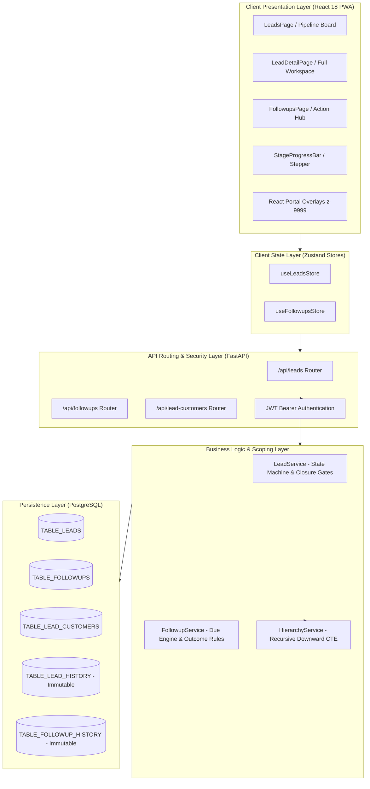
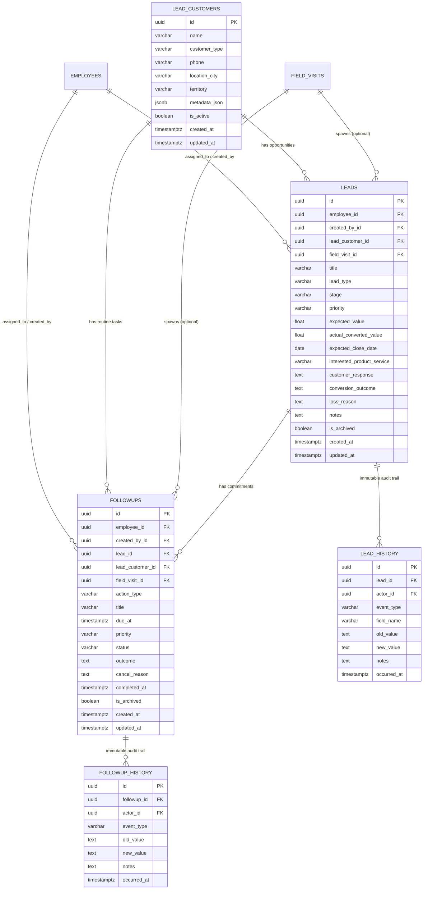
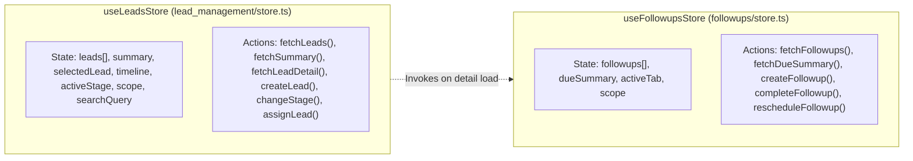
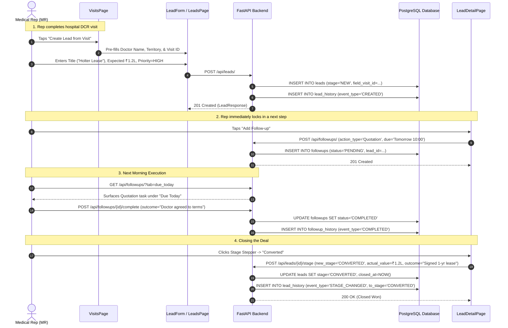
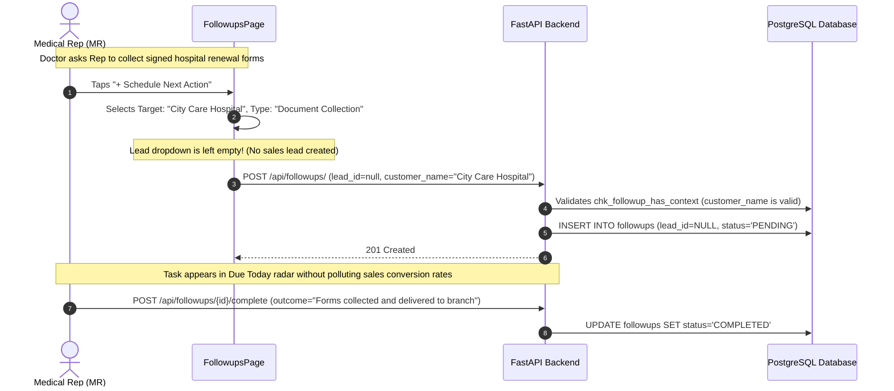

# FSM-CORE: Enterprise Architecture & Technical Specification
## Subsystem: Lead Management (Opportunities) & Follow-ups (Commitment Tracking)

---

## 1. System Overview & Core Invariants

The **Lead Management** and **Follow-ups** subsystems form the commercial revenue execution engine of the FSM Master Core platform. Designed specifically for pharmaceutical and medical device distribution, it solves the two primary operational bottlenecks in healthcare field sales:
1. **Revenue Leakage (~40% of deals die silently):** Commitments made during hospital/clinic visits (pricing sheets, equipment lease proposals, diagnostic sample trials) go unfulfilled due to lack of time-bound accountability.
2. **Context Loss on Field Staff Turnover:** Sales representative churn wipes out relationship history, forcing new representatives to re-interview clinic doctors from scratch.



### The Three Cardinal Architectural Invariants
* **Invariant 1: One Customer $\rightarrow$ Many Concurrent Leads:** A single healthcare provider (doctor, clinic, or hospital) can have multiple distinct commercial deals active at the same time (e.g., an *"Equipment Supply Contract"* and an *"Annual Reagent Diagnostic Agreement"*) without duplicating master customer accounts.
* **Invariant 2: One Lead $\rightarrow$ Zero or Many Follow-ups:** Every opportunity maintains a trail of promised actions. The system calculates overdue commitments dynamically and surfaces deals that lack next steps.
* **Invariant 3: Standalone Follow-ups ("No Fake Leads"):** Over 40% of representative field tasks are routine customer service (e.g., collecting updated GST registration forms, picking up drug license renewals, delivering sample brochures). **A follow-up can exist directly attached to a doctor or field visit without creating a sales lead.** This prevents reps from polluting commercial pipeline conversion rates with administrative reminders.

---

## 2. Database Schema & Data Layer Architecture

All tables use UUID v4 primary keys (`uuid_generate_v4()`), automatic UTC timestamps (`created_at`, `updated_at`), and resolve table names dynamically via the application `TableRegistry` to ensure zero hardcoded table names.



### Table 1: `lead_customers` (Customer Master Directory)
* **Purpose:** Centralized repository for doctors, clinics, hospitals, pharmacies, and distributors.
* **Columns:**
  * `id`: `UUID` (Primary Key).
  * `name`: `VARCHAR(200)` (Indexed, non-null).
  * `customer_type`: `VARCHAR(50)` (Indexed, default `'Doctor'`). Enum: `Doctor`, `Clinic`, `Hospital`, `Pharmacy`, `Distributor`, `Other`.
  * `phone`: `VARCHAR(20)` (Nullable).
  * `location_city`: `VARCHAR(100)` (Indexed).
  * `location_area`: `VARCHAR(150)` (Nullable).
  * `territory`: `VARCHAR(150)` (Indexed).
  * `metadata_json`: `JSONB` (Stores specialty, registration numbers, bed capacity).
  * `is_active`: `BOOLEAN` (Default `TRUE`).
* **Indexes:** `ix_lead_customers_active_type (is_active, customer_type)`, `ix_lead_customers_name`.

### Table 2: `leads` (Commercial Opportunities)
* **Purpose:** Stores sales deals, expected deal values, and stage transitions.
* **Columns:**
  * `id`: `UUID` (Primary Key).
  * `employee_id`: `UUID` (FK $\rightarrow$ `employees.id`, CASCADE). Current owner.
  * `created_by_id`: `UUID` (FK $\rightarrow$ `employees.id`, CASCADE). Creator.
  * `lead_customer_id`: `UUID` (FK $\rightarrow$ `lead_customers.id`, SET NULL). Nullable.
  * `customer_name`: `VARCHAR(200)` (Fallback denormalized name).
  * `customer_type`: `VARCHAR(50)` (Default `'Doctor'`).
  * `title`: `VARCHAR(300)` (Non-null). Deal title.
  * `lead_type`: `VARCHAR(80)` (e.g., *Hospital Service*, *Medicine Supply*, *Medical Equipment*).
  * `interested_product_service`: `VARCHAR(200)` (SKU / Device name).
  * `customer_response`: `VARCHAR(200)` (Doctor's verbatim reaction / objection).
  * `lead_source`: `VARCHAR(80)` (Default `'Doctor Visit'`).
  * `stage`: `VARCHAR(50)` (Indexed). Enum: `NEW`, `CONTACTED`, `INTERESTED`, `QUALIFIED`, `CONVERTED`, `LOST`.
  * `priority`: `VARCHAR(20)` (Indexed). Enum: `LOW`, `MEDIUM`, `HIGH`.
  * `expected_value`: `FLOAT` (Nullable, potential INR deal value).
  * `actual_converted_value`: `FLOAT` (Nullable, mandatory upon `CONVERTED`).
  * `expected_close_date`: `DATE` (Target closing date).
  * `conversion_outcome`: `TEXT` (Mandatory agreement details on `CONVERTED`).
  * `loss_reason`: `TEXT` (Mandatory cancellation reason on `LOST`).
  * `field_visit_id`: `UUID` (FK $\rightarrow$ `field_visits.id`, SET NULL). Links lead to spawning visit.
  * `is_archived`: `BOOLEAN` (Default `FALSE`).
* **Indexes:** `ix_leads_emp_stage (employee_id, stage)`, `ix_leads_stage_priority (stage, priority)`.

### Table 3: `followups` (Actionable Next Steps & Commitments)
* **Purpose:** Time-bound commitments promised to healthcare providers.
* **Columns:**
  * `id`: `UUID` (Primary Key).
  * `employee_id`: `UUID` (FK $\rightarrow$ `employees.id`, CASCADE). Responsible assignee.
  * `created_by_id`: `UUID` (FK $\rightarrow$ `employees.id`, CASCADE). Scheduler.
  * `lead_id`: `UUID` (FK $\rightarrow$ `leads.id`, SET NULL). **Nullable!** Supports standalone tasks.
  * `lead_customer_id`: `UUID` (FK $\rightarrow$ `lead_customers.id`, SET NULL).
  * `field_visit_id`: `UUID` (FK $\rightarrow$ `field_visits.id`, SET NULL).
  * `customer_name`: `VARCHAR(200)` (Denormalized display name).
  * `action_type`: `VARCHAR(80)`. Enum: `Call`, `Revisit`, `Quotation`, `Demo`, `Document Collection`, `Payment Reminder`, `Other`.
  * `title`: `VARCHAR(300)` (Action description).
  * `due_at`: `TIMESTAMPTZ` (UTC due date/time, Indexed).
  * `priority`: `VARCHAR(20)` (Enum: `LOW`, `MEDIUM`, `HIGH`).
  * `status`: `VARCHAR(30)` (Indexed). Enum: `PENDING`, `COMPLETED`, `CANCELLED`.
  * `outcome`: `TEXT` (Mandatory upon completion).
  * `cancel_reason`: `TEXT` (Mandatory upon cancellation).
  * `completed_at`: `TIMESTAMPTZ` (UTC completion timestamp).
* **Constraints & Invariants:**
  * `chk_followup_has_context`: `CheckConstraint("lead_id IS NOT NULL OR lead_customer_id IS NOT NULL OR field_visit_id IS NOT NULL")`. Ensures no orphan tasks exist.
  * Runtime Property: `is_overdue` is dynamically derived (`status == PENDING && due_at < NOW()`). It is never stored as a static state in the database.
* **Indexes:** `ix_followups_emp_status_due (employee_id, status, due_at)`.

### Tables 4 & 5: `lead_history` & `followup_history` (Immutable Audit Ledgers)
* **Purpose:** Provide non-repudiable audit trails for clinical governance and sales dispute resolution.
* **`lead_history` Columns:** `id`, `lead_id`, `actor_id`, `event_type` (`CREATED`, `STAGE_CHANGED`, `ASSIGNED`, `CLOSED`, `REOPENED`, `UPDATED`), `field_name`, `old_value`, `new_value`, `notes`, `occurred_at`.
* **`followup_history` Columns:** `id`, `followup_id`, `actor_id`, `event_type` (`CREATED`, `COMPLETED`, `RESCHEDULED`, `CANCELLED`, `REASSIGNED`), `old_value`, `new_value`, `notes`, `occurred_at`.

---

## 3. Backend Service Logic & Business Rules

### 3.1 Recursive Downward Hierarchy Scoping (`HierarchyService`)
Access control enforces reporting tree isolation through a recursive Common Table Expression (CTE) executed in PostgreSQL:

```sql
WITH RECURSIVE subordinates AS (
    SELECT id, reports_to_id, 1 as depth
    FROM employees
    WHERE id = :current_employee_id
    UNION ALL
    SELECT e.id, e.reports_to_id, s.depth + 1
    FROM employees e
    JOIN subordinates s ON e.reports_to_id = s.id
)
SELECT id FROM subordinates;
```

* When `scope='my'`: Query filters strictly by `employee_id == current_employee.id`.
* When `scope='all'`: Query filters by `employee_id.in_(subordinate_ids)`.
* Role Matrix:
  * **MR / Field Sales Officer:** `subordinate_ids = [self]`. Cannot view other representatives' leads.
  * **RSM / Team Lead:** Views own pipeline + all assigned Field Sales Officers in their team.
  * **ZSM / Branch Manager:** Views own pipeline + all Team Leads and FSOs within their zone.
  * **Executive Director / Admin:** Recursive check returns `None` (unrestricted global query).

### 3.2 Lead State Machine & Mandatory Closure Gates (`LeadService`)

```
   [ NEW ] ──► [ CONTACTED ] ──► [ INTERESTED ] ──► [ QUALIFIED ]
      │              │                  │                  │
      └──────────────┴──────────────────┴──────────────────┤
                                                           ▼
                                            ┌──────────────┴──────────────┐
                                            ▼                             ▼
                                      [ CONVERTED ]                    [ LOST ]
                              (actual_value & outcome req)        (loss_reason req)
```

* **Validation Rules:**
  1. `change_stage(lead_id, new_stage)`:
     * If `new_stage == 'CONVERTED'`: Validates that `conversion_outcome` is non-empty. Updates `closed_at = NOW()` and persists `actual_converted_value`.
     * If `new_stage == 'LOST'`: Validates that `loss_reason` is non-empty. Updates `closed_at = NOW()`.
     * If transitioning from a closed state (`CONVERTED`/`LOST`) back to an active state: Resets `closed_at = NULL` and appends a `REOPENED` event in `lead_history`.
  2. `reassign_lead(lead_id, new_employee_id, notes)`:
     * Validates that `new_employee_id` exists, is active, and is within the manager's downward hierarchy.
     * Prevents reassigning to self if already assigned.
     * Appends an `ASSIGNED` event in `lead_history` recording previous owner and new owner.

### 3.3 Dynamic Runtime Overdue Calculation Engine (`FollowupService`)
* **Timezone Safety:** All dates are stored in UTC.
* **Partitioning Logic:**
  * **Due Today:** `status == 'PENDING'` AND `due_at >= UTC_START_OF_TODAY` AND `due_at <= UTC_END_OF_TODAY`.
  * **Overdue:** `status == 'PENDING'` AND `due_at < NOW()`.
  * **Upcoming:** `status == 'PENDING'` AND `due_at > UTC_END_OF_TODAY`.
  * **Completed:** `status == 'COMPLETED'`.
* **Execution Validation:**
  * `complete_followup(id, outcome)`: Blocks submission if `outcome` is blank. Sets `status = 'COMPLETED'` and `completed_at = NOW()`. Appends `COMPLETED` in `followup_history`.
  * `reschedule_followup(id, new_due_at, reason)`: Blocks if `reason` is blank or `new_due_at <= NOW()`. Records `old_due_at` and `new_due_at` in `followup_history`.

---

## 4. Complete REST API Specification

### 4.1 Customer Master APIs (`/api/lead-customers`)

#### `GET /api/lead-customers/search`
* **Query Params:** `q` (string, fuzzy search name or phone), `customer_type` (Doctor, Clinic, Hospital), `limit` (int, default 15).
* **Response (200 OK):**
```json
[
  {
    "id": "c1a2b3c4-0000-0000-0000-000000000001",
    "name": "Dr. Jane Smith (Cardiologist)",
    "customer_type": "Doctor",
    "phone": "+91 98200 12345",
    "location_city": "Mumbai",
    "location_area": "Bandra West",
    "territory": "South Mumbai Beat 1",
    "is_active": true,
    "created_at": "2026-10-20T10:00:00Z",
    "updated_at": "2026-10-20T10:00:00Z"
  }
]
```

#### `POST /api/lead-customers/`
* **Payload:**
```json
{
  "name": "Apollo Super Specialty Hospital",
  "customer_type": "Hospital",
  "phone": "+91 22 2456 7890",
  "location_city": "Mumbai",
  "location_area": "Navi Mumbai",
  "territory": "Navi Mumbai Zone"
}
```
* **Response:** `201 Created` with full `LeadCustomerResponse`.

---

### 4.2 Lead Management APIs (`/api/leads`)

#### `GET /api/leads/summary`
* **Response (200 OK):**
```json
{
  "total_leads": 42,
  "open_leads": 35,
  "new_leads": 12,
  "contacted_leads": 8,
  "interested_leads": 10,
  "qualified_leads": 5,
  "converted_leads": 5,
  "lost_leads": 2,
  "needs_attention_count": 4,
  "total_pipeline_value": 3450000.0,
  "my_leads_count": 14
}
```

#### `GET /api/leads/`
* **Query Params:**
  * `stage`: `NEW`, `CONTACTED`, `INTERESTED`, `QUALIFIED`, `CONVERTED`, `LOST`
  * `priority`: `HIGH`, `MEDIUM`, `LOW`
  * `scope`: `my` (own leads) or `all` (hierarchy tree)
  * `search`: string (matches title, customer_name, location_city)
* **Response (200 OK):**
```json
[
  {
    "id": "e4b1a8c0-1111-2222-3333-444455556666",
    "employee_id": "99999999-0000-0000-0000-000000000001",
    "employee_name": "Ravi Kumar (MR)",
    "created_by_id": "99999999-0000-0000-0000-000000000001",
    "lead_customer_id": "c1a2b3c4-0000-0000-0000-000000000001",
    "customer_name": "Dr. Jane Smith (Cardiologist)",
    "customer_type": "Doctor",
    "title": "Diagnostic Holter Monitor Partnership",
    "lead_type": "Medical Equipment",
    "interested_product_service": "Wireless 3-Channel Holter",
    "customer_response": "Expressed interest in outpatient cardiac screening rental.",
    "lead_source": "Doctor Visit",
    "stage": "INTERESTED",
    "priority": "HIGH",
    "expected_value": 120000.0,
    "actual_converted_value": null,
    "expected_close_date": "2026-11-15",
    "location_city": "Mumbai",
    "contact_person": "Dr. Jane Smith",
    "contact_phone": "+91 98200 12345",
    "notes": "Clinic requires tier-1 consumable pricing discount.",
    "next_follow_up_due": "2026-10-29T10:00:00Z",
    "next_follow_up_title": "Send wireless Holter quotation & lease terms",
    "pending_followups_count": 1,
    "is_archived": false,
    "created_at": "2026-10-26T09:30:00Z",
    "updated_at": "2026-10-27T11:45:00Z"
  }
]
```

#### `POST /api/leads/`
* **Payload:**
```json
{
  "title": "Cardiac Panel Reagents Annual Supply",
  "lead_type": "Medicine supply",
  "customer_name": "Fortis Hospital Pathology Lab",
  "customer_type": "Hospital",
  "lead_customer_id": "c1a2b3c4-0000-0000-0000-000000000002",
  "field_visit_id": "a1b2c3d4-0000-0000-0000-000000000099",
  "interested_product_service": "Troponin I & CK-MB Reagents",
  "customer_response": "Tender opening on 15th Nov.",
  "lead_source": "Doctor Visit",
  "stage": "NEW",
  "priority": "HIGH",
  "expected_value": 350000.0,
  "expected_close_date": "2026-11-20",
  "location_city": "Mumbai",
  "contact_person": "Dr. Sharma (HOD)",
  "contact_phone": "+91 98111 22334",
  "notes": "Spoke during DCR beat visit. High urgency."
}
```
* **Response:** `201 Created` with full `LeadResponse`.

#### `POST /api/leads/{id}/stage`
* **Payload:**
```json
{
  "new_stage": "CONVERTED",
  "actual_value": 340000.0,
  "conversion_outcome": "Signed annual supply contract for 400 kits/month. First delivery scheduled for 10th Nov.",
  "notes": "Approved by Regional Manager with 5% volume rebate."
}
```
* **Response:** `200 OK` with updated `LeadResponse`.

#### `POST /api/leads/{id}/assign`
* **Payload:**
```json
{
  "new_employee_id": "88888888-0000-0000-0000-000000000002",
  "notes": "Ravi is taking medical leave; reassigned to Suresh for territory coverage."
}
```
* **Response:** `200 OK` with updated `LeadResponse`.

#### `GET /api/leads/{id}/timeline`
* **Response (200 OK):**
```json
[
  {
    "id": "t1-0000-0000-0000-000000000001",
    "lead_id": "e4b1a8c0-1111-2222-3333-444455556666",
    "actor_id": "99999999-0000-0000-0000-000000000001",
    "actor_name": "Ravi Kumar (MR)",
    "event_type": "CREATED",
    "field_name": "stage",
    "old_value": null,
    "new_value": "NEW",
    "notes": "Opportunity logged from DCR field visit",
    "occurred_at": "2026-10-26T09:30:00Z"
  },
  {
    "id": "t1-0000-0000-0000-000000000002",
    "lead_id": "e4b1a8c0-1111-2222-3333-444455556666",
    "actor_id": "99999999-0000-0000-0000-000000000001",
    "actor_name": "Ravi Kumar (MR)",
    "event_type": "STAGE_CHANGED",
    "field_name": "stage",
    "old_value": "NEW",
    "new_value": "INTERESTED",
    "notes": "Doctor confirmed clinic interest in diagnostic trial",
    "occurred_at": "2026-10-27T11:45:00Z"
  }
]
```

---

### 4.3 Follow-up Action APIs (`/api/followups`)

#### `GET /api/followups/due-summary`
* **Response (200 OK):**
```json
{
  "due_today": 7,
  "overdue": 3,
  "upcoming": 14,
  "completed_today": 4
}
```

#### `GET /api/followups/`
* **Query Params:**
  * `tab`: `due_today`, `overdue`, `upcoming`, `completed`, `all`
  * `lead_id`: UUID (filters follow-ups attached to a specific deal)
  * `field_visit_id`: UUID (filters follow-ups attached to a specific visit)
  * `scope`: `my` or `all`
* **Response (200 OK):**
```json
[
  {
    "id": "f1-0000-0000-0000-000000000001",
    "employee_id": "99999999-0000-0000-0000-000000000001",
    "employee_name": "Ravi Kumar (MR)",
    "created_by_id": "99999999-0000-0000-0000-000000000001",
    "lead_id": "e4b1a8c0-1111-2222-3333-444455556666",
    "lead_title": "Diagnostic Holter Monitor Partnership",
    "customer_name": "Dr. Jane Smith (Cardiologist)",
    "action_type": "Quotation",
    "title": "Send wireless Holter quotation & lease terms",
    "due_at": "2026-10-28T10:00:00Z",
    "priority": "HIGH",
    "status": "PENDING",
    "is_overdue": true,
    "notes": "Share tier-1 discounted pricing approved by regional manager.",
    "outcome": null,
    "completed_at": null,
    "created_at": "2026-10-26T09:35:00Z"
  }
]
```

#### `POST /api/followups/{id}/complete`
* **Payload:**
```json
{
  "outcome": "Delivered pricing sheet in person. Dr. Sharma reviewed and requested clinical demo on Friday."
}
```
* **Response:** `200 OK` with updated `FollowupResponse`.

#### `POST /api/followups/{id}/reschedule`
* **Payload:**
```json
{
  "new_due_at": "2026-10-31T14:30:00Z",
  "reason": "Doctor called into emergency cardiology procedure; requested afternoon visit."
}
```
* **Response:** `200 OK` with updated `FollowupResponse`.

---

## 5. Frontend Architecture & Client State Management

### 5.1 Zustand Client State Stores



* **Cache & Synchronization Strategy:**
  * When `createLead()` succeeds: prepends to `leads[]` and immediately triggers background `fetchSummary()`.
  * When `changeStage()` succeeds: updates the specific lead in `leads[]` and `selectedLead`, re-fetches the immutable `timeline`, and invalidates `summary`.
  * When `completeFollowup()` succeeds: mutates the target follow-up in `followups[]`, invalidates `dueSummary`, and reloads the active opportunity's action checklist.

---

### 5.2 Key Frontend Components & UI Structure

* **`LeadsPage.tsx`:** Primary pipeline screen. Renders stage filter pills (`ALL`, `NEW`, `CONTACTED`, `INTERESTED`, `QUALIFIED`, `CONVERTED`, `LOST`, `ATTENTION`), search input, and responsive card grid.
* **`LeadCard.tsx`:** High-density opportunity card. Renders deal title, doctor name, formatted Indian currency (`₹18.4L`), priority badge, representative name, and early-warning next action badge.
* **`LeadDetailPage.tsx` (Full-Page Opportunity Workspace):**
  * Replaced the broken 50% slide-over drawer with a full-width, 2-column layout.
  * Back-navigation header (`← Back to Opportunities Pipeline`) preserving active filters.
  * Left Column: Primary contact card with click-to-call `tel:` link, territory, expected close date, qualitative clinical demand notes, and Scheduled Next Steps sub-list.
  * Right Column: Immutable audit timeline (`LeadTimeline.tsx`).
* **`StageProgressBar.tsx`:** Horizontal progress stepper showing stages 1 to 5 (`New` $\rightarrow$ `Contacted` $\rightarrow$ `Interested` $\rightarrow$ `Qualified` $\rightarrow$ `Converted`) with purple checkmarks, active glowing pulse, and one-click stage change triggers.
* **`FollowupsPage.tsx`:** Daily execution cockpit with KPI summary cards (`Due Today`, `Overdue`, `Upcoming`, `Completed`), action type tabs, and quick-action triggers.

---

### 5.3 Solving the CSS Stacking Context & Strobe Flickering Glitch

#### The Root Cause Bug
When hovering over a `FollowupCard` to click **"Mark Done"**, the card's CSS class `.card-elevation:hover` applied:
```css
transform: translateY(-2px);
```
Under W3C CSS specifications, applying any non-identity `transform` to an ancestor creates a **new local stacking context and containing block** for all descendants. As a consequence:
1. The child modal (which had `position: fixed; inset: 0;`) ceased to position relative to the browser viewport. Instead, it was trapped inside the 300px width of the card and clipped by `overflow: hidden`.
2. When the user's cursor moved inside the modal, the card lost its hover state.
3. Losing hover removed the `transform`, causing the modal to snap to the full screen.
4. Snapping to full screen placed the modal under the cursor again, which re-triggered the parent card's hover state.
5. This produced an **infinite layout ping-pong running at 60 FPS**, appearing on screen as a violent flickering light strobe.

#### The Production Architectural Solution: React Portals
All modal dialogs were refactored to mount to `document.body` via `createPortal`:

```tsx
import { createPortal } from 'react-dom';

export const CompleteFollowupModal: React.FC<Props> = ({ isOpen, onClose, ... }) => {
  if (!isOpen) return null;

  return createPortal(
    <div className="fixed inset-0 z-[9999] flex items-center justify-center p-4 bg-slate-950/50 backdrop-blur-sm animate-in fade-in duration-150">
      <div className="fixed inset-0 -z-10" onClick={onClose} />
      <div className="bg-white rounded-3xl w-full max-w-md shadow-2xl border border-slate-100 overflow-hidden">
        {/* Modal content */}
      </div>
    </div>,
    document.body
  );
};
```

* **Result:** Modals render directly under `<body>` in the DOM tree, entirely detached from parent component hierarchies, CSS transforms, and `overflow` clipping boundaries.

---

## 6. End-to-End Operational Lifecycle & Process Flows

### Flow A: The Revenue Generation Loop (Visit $\rightarrow$ Lead $\rightarrow$ Action $\rightarrow$ Close)



---

### Flow B: Routine Customer Care (Standalone Follow-up, Zero Fake Leads)



---

### Flow C: Manager Pipeline Coaching & Downward Reassignment

```mermaid
sequenceDiagram
    autonumber
    actor Manager as Regional Manager (RSM)
    participant UI as LeadsPage / LeadDetailPage
    participant API as FastAPI Backend
    participant DB as PostgreSQL Database
    actor RepB as Rep B (Available Rep)

    Manager->>UI: Toggles Scope from "My Leads" to "Team Pipeline"
    UI->>API: GET /api/leads/?scope=all
    API->>DB: Executes Recursive CTE on downward reporting tree
    API-->>UI: Returns all team deals
    Manager->>UI: Clicks "⚠️ Needs Attention" Filter
    UI-->>Manager: Flags ₹4.5L deal at City Hospital (Rep A is on sick leave, 2 overdue tasks)
    Manager->>UI: Clicks Deal -> "Reassign"
    UI->>API: GET /api/employees/directory
    API-->>UI: Returns active subordinates
    Manager->>UI: Selects Rep B, enters note: "Rep A on medical leave; urgent tender quote"
    UI->>API: POST /api/leads/{id}/assign
    API->>DB: UPDATE leads SET employee_id=RepB.id
    API->>DB: INSERT INTO lead_history (event_type='ASSIGNED', old_value=RepA, new_value=RepB)
    API-->>UI: 200 OK

    Note over RepB,API: Rep B opens app, immediately sees deal and reads full 6-month timeline
    RepB->>API: GET /api/leads/{id}
    API-->>RepB: Returns opportunity with full context preserved
```

---

## 7. Deliverables & Verification Checklist

* [x] **Database Constraints:** Invariants enforced via check constraints (`chk_followup_has_context`) and foreign key cascades.
* [x] **Immutable Audit Tables:** `lead_history` and `followup_history` capture non-repudiable logs of all mutations.
* [x] **Recursive RBAC:** HierarchyService verified with downward reporting tree scoping.
* [x] **Zustand State Stores:** Full optimistic updates and cache invalidation implemented in `useLeadsStore` and `useFollowupsStore`.
* [x] **Browser Stacking Glitch:** Solved via React Portals mounting directly to `document.body` with `z-[9999]`.
* [x] **Production Build:** Passes `npm run build` with **0 TypeScript and Vite errors**.

