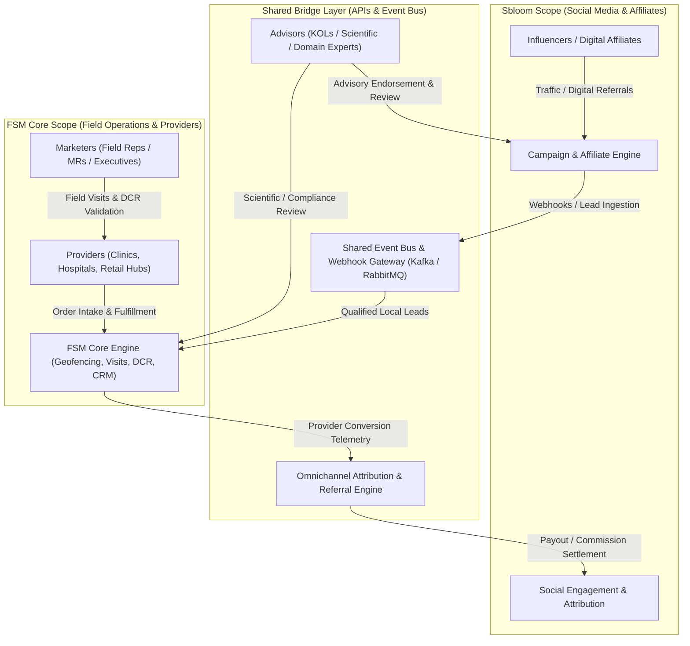
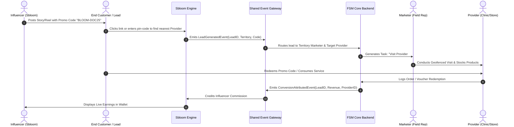

# FSM Core & Sbloom Shared Engineering Specification
**Cross-Platform Architecture Matrix: Providers, Advisors, Marketers, and Influencers**

---

## 1. Executive Context & System Boundary Ownership

This architecture specification defines the boundary ownership, user personas, interface tiers, application logic, and data models for the joint engineering collaboration between **FSM Core Platform** and **Sbloom**.



### Team Boundary Division
* **FSM Core Team Scope**:
  * **Providers**: Facilities, clinics, hospitals, pharmacies, dealers, and partner institutions delivering end products/services.
  * **Marketers**: Physical on-ground workforce (Field Reps, MRs, Area Executives, Territory Managers).
* **Sbloom Team Scope**:
  * **Influencers**: Digital creators, social media affiliates, KOL ambassadors driving digital traffic, social campaigns, and promo codes.
* **Shared / Bridge Scope**:
  * **Advisors**: Domain experts, Key Opinion Leaders (KOLs), senior physicians, or technical specialists validating content, advising both providers and field teams, and providing scientific backing.

---

## 2. Master 4x4 Cross-Platform Engineering Matrix

| Layer | Providers (FSM Scope) | Advisors (Shared Scope) | Marketers / Field Reps (FSM Scope) | Influencers (Sbloom Scope) |
| :--- | :--- | :--- | :--- | :--- |
| **Functionality**<br>*(What features they need)* | • Onboarding & KYC verification<br>• Service / Product catalog access<br>• Inventory & order placement<br>• Marketer appointment scheduling<br>• Lead fulfillment & patient/client intake<br>• Billing, invoice, & disbursement history | • Clinical / Scientific content validation<br>• Advisory board webinar/session hosting<br>• Product evaluation & peer review<br>• Marketer query resolution (Ask-an-Expert)<br>• Endorsement & campaign review<br>• Honorarium & compliance reporting | • Geofenced GPS attendance & punch-in/out<br>• Field visit planning & route optimization<br>• Daily Call Reports (DCR) with Doctor/Clinic<br>• Digital sample/collateral distribution<br>• Provider onboarding & relationship tracking<br>• Expense claims with anti-fraud OCR receipts | • Social affiliate dashboard & campaign briefs<br>• Unique referral links & discount promo codes<br>• Content submission & pre-publish approval<br>• Social channel performance tracking<br>• Real-time commission & conversion tracking<br>• Automated payout wallet & banking setup |
| **UI/UX**<br>*(What their interface looks like)* | • Web Portal + Tablet Responsive UI<br>• Clean, uncluttered B2B enterprise layout<br>• High-contrast order tables & quick buttons<br>• Real-time notification drawer for orders/visits<br>• Secure document upload drag-and-drop zone | • Desktop Web Portal + iPad Reader UI<br>• Document-centric preview (PDF annotations)<br>• Review workflow queues (Approve/Flag/Reject)<br>• High-resolution video session interface<br>• Formal executive typography and minimal noise | • Mobile PWA First (Android / iOS native feel)<br>• Quick action bottom sheets & thumb navigation<br>• Offline-first banner with auto-sync indicators<br>• Map view with GPS route polylines<br>• Fast multi-camera punch & receipt capture | • Mobile-First Creator App + Dark Mode UI<br>• Visually rich, influencer-centric aesthetics<br>• Interactive conversion sparklines & charts<br>• 1-click link copying & social sharing sheets<br>• Earnings gamification tiers & milestone badges |
| **Application**<br>*(What application logic supports them)* | • Provider status state machine (`ONBOARDING` &rarr; `VERIFIED` &rarr; `ACTIVE`)<br>• Inventory allocation & order routing engine<br>• Marketer visit slot reservation logic<br>• Automated invoice & receipt generation<br>• SLA monitoring for fulfillment | • Content review & approval workflow engine<br>• Conflict-of-Interest (COI) compliance checks<br>• Tiered honorarium calculation logic<br>• Bi-directional Q&A routing to field marketers<br>• Digital signature & attestation verification | • Recursive CTE hierarchy scoping (`ADMIN` &rarr; `ZSM` &rarr; `RSM` &rarr; `MR`)<br>• Geofence radius validation (Haversine/PostGIS)<br>• Anti-fraud camera capture & EXIF delta check<br>• Offline IndexedDB sync with merge conflict resolution<br>• Visit completion state machine | • Click/lead tracking & cookie attribution engine<br>• Multi-tier affiliate commission calculator<br>• Fraud detection (bot traffic, click-farms)<br>• Automated promo code generator with expiry<br>• Sbloom payout disbursement gateway integration |
| **Data**<br>*(What data they access or manage)* | • **Access**: Own facility profile, catalog prices, active orders, assigned marketer info<br>• **Manage**: Facility details, staff contacts, intake requests, order acknowledgments, feedback | • **Access**: Clinical trial docs, marketing collaterals, provider efficacy logs, assigned queries<br>• **Manage**: Advisory comments, peer approval stamps, consultation schedules, session notes | • **Access**: Assigned route plan, provider directory, monthly targets, expense status, org tree<br>• **Manage**: Punch logs, GPS telemetry, visit logs, DCR notes, expense receipts, task progress | • **Access**: Active campaign briefs, approved creative assets, commission rates, gross clicks<br>• **Manage**: Social handles, payment payout details, submitted media proof, affiliate links |

---

## 3. Deep-Dive Specification by Persona

### 3.1 Providers (Client Service / Medical / Retail Facilities)
* **Role in Ecosystem**: The operational core where physical transactions, client treatments, or product applications occur.
* **Core Workflows**:
  1. **Self-Service / Rep-Assisted Onboarding**: Submission of regulatory licenses, GST/tax IDs, address proof, and facility photos.
  2. **Visit & Interaction Management**: Confirming or rescheduling field representative visits; logging feedback on samples received.
  3. **Demand & Stock Ledger**: Placing replenishment requests for promotional materials, diagnostic kits, or retail stock.
* **Data Privacy & Security**:
  * Strict tenant isolation via dynamic TableRegistry.
  * Role-based access ensures providers only see their own order history and designated liaison representatives.

### 3.2 Advisors (Key Opinion Leaders & Domain Specialists)
* **Role in Ecosystem**: The trust and compliance anchor connecting scientific/technical validity with commercial execution.
* **Core Workflows**:
  1. **Pre-Publication Collateral Review**: Reviewing influencer marketing briefs and field rep detail aids for technical/medical accuracy before dissemination.
  2. **Advisory Board Engagements**: Participating in roundtables, symposiums, and training sessions for field representatives.
  3. **Field Escalation Resolution**: Answering technical questions raised by providers to field marketers during visits.
* **Compliance Safeguards**:
  * Audit logging of all approvals, comments, and timestamps in [`audit_log`](file:///c:/Users/harin/Downloads/fsm/backend/app/models/audit_log.py).
  * Automated disclosures and conflict-of-interest checks.

### 3.3 Marketers (Field Representatives / Field Executives)
* **Role in Ecosystem**: The on-ground execution engine managed by **FSM Core**.
* **Core Workflows**:
  1. **Geofenced Attendance & Session Tracking**: Clocking in at designated territory hubs; maintaining travel mileage via [`field_sessions`](file:///c:/Users/harin/Downloads/fsm/backend/app/models/field_session.py).
  2. **Daily Call Reporting (DCR)**: Executing planned visits to doctors, dealers, or farmers with GPS verification and discussion notes via [`field_visits`](file:///c:/Users/harin/Downloads/fsm/backend/app/models/field_visit.py).
  3. **Offline Resilience**: Recording check-ins and field notes in low-connectivity areas with automatic sync upon reconnection.
  4. **Expense Submissions**: Capturing live receipt photos with anti-fraud validations (camera-only proof, timestamp delta, duplicate hash detection).

### 3.4 Influencers (Sbloom Managed Creators & Affiliates)
* **Role in Ecosystem**: The top-of-funnel digital engine driving brand awareness, consumer demand, and digital referrals managed by **Sbloom**.
* **Core Workflows**:
  1. **Campaign Onboarding**: Selecting available brand campaigns and generating tracked shortlinks and promo codes.
  2. **Creative Content Submission**: Uploading draft videos/reels/posts for brand & advisor compliance approval before publishing.
  3. **Performance & Attribution Tracking**: Monitoring clicks, unique conversions, attributed provider visits, and earned commissions.
  4. **Instant Wallet Settlement**: Receiving milestone bonuses and affiliate payouts directly to bank accounts.

---

## 4. Cross-Platform Shared Engineering Architecture

### 4.1 Closed-Loop Attribution Architecture
One of the most critical requirements for the shared engineering team is connecting **digital influencer activity** with **on-ground field conversions and provider orders**.



### 4.2 Shared Data Contracts (JSON Schemas)

#### Event 1: `LeadDispatchedEvent` (Sbloom &rarr; FSM Core)
```json
{
  "event_id": "evt_883901a",
  "event_type": "LEAD_DISPATCHED",
  "timestamp": "2026-10-29T10:15:30Z",
  "source": "sbloom_affiliate_engine",
  "payload": {
    "lead_id": "lead_9921",
    "influencer_id": "inf_302",
    "campaign_id": "cmp_fall_pharma_2026",
    "promo_code": "BLOOM-DRSMITH",
    "customer_zipcode": "400001",
    "target_territory": "South Mumbai Zone",
    "recommended_provider_id": "prv_4401"
  }
}
```

#### Event 2: `ConversionSettledEvent` (FSM Core &rarr; Sbloom)
```json
{
  "event_id": "evt_991024b",
  "event_type": "CONVERSION_SETTLED",
  "timestamp": "2026-10-29T14:45:10Z",
  "source": "fsm_core_engine",
  "payload": {
    "conversion_id": "cnv_7712",
    "lead_id": "lead_9921",
    "influencer_id": "inf_302",
    "provider_id": "prv_4401",
    "field_rep_id": "22222222-2222-2222-2222-222222222222",
    "order_amount": 3450.00,
    "currency": "INR",
    "settled_at": "2026-10-29T14:45:00Z"
  }
}
```

---

## 5. Summary of Key Alignment Points for the Meeting

1. **System Ownership Boundary**:
   * **Sbloom** owns Influencer management, affiliate link generation, social campaign analytics, and influencer payout disbursement.
   * **Our Team (FSM Core)** owns Provider registration, inventory/order fulfillment, Marketer (Field Rep) geofenced attendance, route planning, visits, and DCR validation.
   * **Shared Advisory**: Advisors act as cross-platform compliance gatekeepers for both influencer campaigns and field rep detailing aids.
2. **Decoupled Architecture**:
   * Communicating via an asynchronous event broker or webhook gateway guarantees high uptime; if either platform undergoes maintenance, operations on the other platform continue uninterrupted.
3. **Data Security & Privacy**:
   * Internal field representative PII, GPS routes, and internal expense records remain strictly inside FSM Core, sending only aggregated conversion and attribution tokens to Sbloom.
