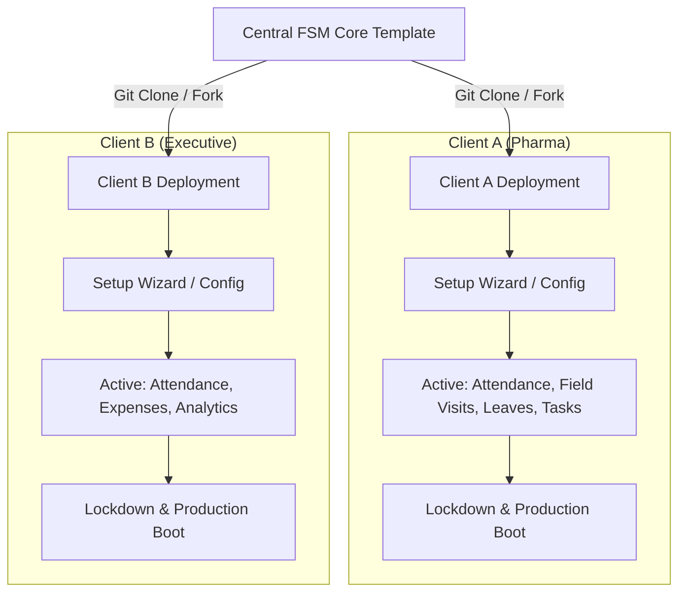
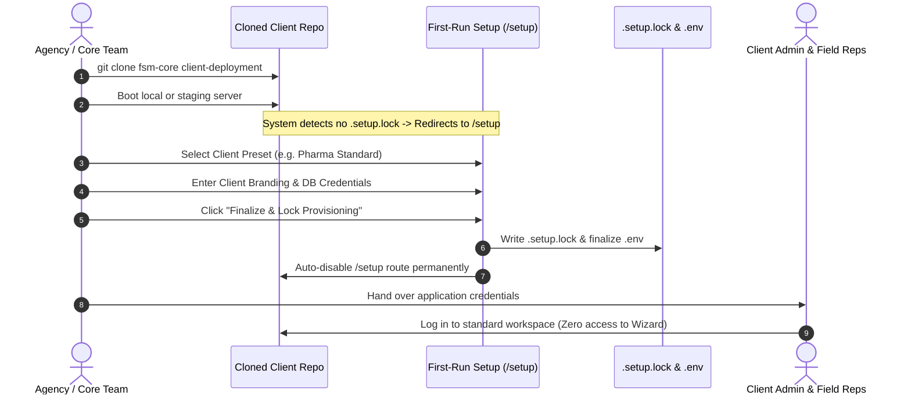

# Client Setup Wizard & Dynamic Feature Provisioning Report
**FSM Core Multi-Vertical Architecture & White-Label Provisioning System**

---

## 1. Executive Summary

This report documents the architectural design, implementation, and deployment workflows for the **Client Setup Wizard** within the central **FSM Core** repository. 

The primary business objective of this central repository is to act as a **master template**. When onboarding a new client:
1. The repository is cloned for the specific client deployment.
2. The client's subscribed features (e.g. *Pharma Standard*, *Expense Anti-Fraud*, *Executive Analytics*) are provisioned.
3. The client's company branding, database tables, and employee hierarchy are configured.
4. The system is locked and delivered to the client so employees and managers operate strictly within their purchased scope without the ability to self-unlock unauthorized features.



---

## 2. Current Wizard Implementation & Architecture

### 2.1 Backend Pluggable Architecture

The backend implements a decoupled feature registry designed around zero-crash resilience:

- **Registry Definition** ([`backend/app/config.py`](file:///c:/Users/harin/Downloads/fsm/backend/app/config.py)):
  ```python
  class FeatureRegistry(BaseModel):
      attendance: bool = True       # Core essential
      field_visits: bool = True     # Modular
      leaves: bool = True           # Modular
      tasks: bool = True            # Modular
      expenses: bool = True         # Feature 1 Plugin
      analytics: bool = True        # Feature 2 Plugin
  ```
- **Dynamic Configuration Endpoints** ([`backend/app/main.py`](file:///c:/Users/harin/Downloads/fsm/backend/app/main.py)):
  - `GET /api/config/features`: Returns the live JSON status of all modules.
  - `POST /api/config/features`: Updates active modules at runtime without restarting the server.
- **Fail-Safe Dynamic Feature Mounting**:
  Feature routers are mounted using guarded dynamic imports:
  ```python
  if settings.features.expenses:
      try:
          from app.features.expenses import router as expenses_router
          app.include_router(expenses_router)
      except ImportError:
          pass  # Graceful fallback if folder is deleted
  ```

### 2.2 Frontend Dynamic State & UI Presentation

- **Feature Store** ([`frontend/src/store/featureStore.ts`](file:///c:/Users/harin/Downloads/fsm/frontend/src/store/featureStore.ts)):
  Maintains reactive module state in Zustand and syncs changes with the backend API.
- **Setup Wizard Modal** ([`frontend/src/components/SetupWizardModal.tsx`](file:///c:/Users/harin/Downloads/fsm/frontend/src/components/SetupWizardModal.tsx)):
  - Supports **Instant Vertical Presets** (Pharma Standard, Full Suite 6/6, Finance & Executive, Minimal Field Force).
  - Provides interactive toggle switches for each modular feature.
  - Synchronizes changes instantly upon clicking **"Apply Configuration"**.
- **Dynamic Presentation Shell** ([`frontend/src/components/AppShell.tsx`](file:///c:/Users/harin/Downloads/fsm/frontend/src/components/AppShell.tsx) and [`frontend/src/components/NavigationDrawer.tsx`](file:///c:/Users/harin/Downloads/fsm/frontend/src/components/NavigationDrawer.tsx)):
  - Navigation tabs and drawer menu entries conditionally render based on active features.
  - Includes route-fallback safety in [`frontend/src/App.tsx`](file:///c:/Users/harin/Downloads/fsm/frontend/src/App.tsx): if an active feature is disabled while an employee is on that tab, the app automatically transitions back to the Home Dashboard without errors.

---

## 3. Analysis: The Employee Dashboard Security Risk

> [!CAUTION]
> **Identified Vulnerability**: If the Setup Wizard is exposed on the employee dashboard, regular field employees or client administrators could enable unpurchased enterprise features (such as Expense Anti-Fraud or Analytics) without paying licensing fees.

### 3-Tier Defense Strategy

```
                          [ Field Employee ]
                                  │
                                  ▼
    ┌──────────────────────────────────────────────────────────────┐
    │ Layer 1: Frontend Role-Based Access Control (RBAC)           │
    │ - Wizard trigger button completely hidden if role != 'ADMIN' │
    └─────────────────────────────┬────────────────────────────────┘
                                  │ (Attacker bypasses UI via Console)
                                  ▼
    ┌──────────────────────────────────────────────────────────────┐
    │ Layer 2: Backend API Authorization Guard                     │
    │ - POST /api/config/features enforces RequireRole('ADMIN')     │
    │ - Non-admin requests receive HTTP 403 Forbidden              │
    └─────────────────────────────┬────────────────────────────────┘
                                  │ (Admin attempts unpurchased feature)
                                  ▼
    ┌──────────────────────────────────────────────────────────────┐
    │ Layer 3: Central Repository Delivery Isolation / Licensing   │
    │ - Wizard operates in a one-time "First-Run" `/setup` phase   │
    │ - OR unpurchased feature folders are physically pruned       │
    └──────────────────────────────────────────────────────────────┘
```

---

## 4. Delivery & Provisioning Approaches for New Clients

When cloning this central repository for a new client, you have four distinct architectural options for when and where the wizard operates:

| Approach | Operational Timing | Location / Interface | How Features Are Locked | Primary Benefit |
| :--- | :--- | :--- | :--- | :--- |
| **Option 1: First-Run Web Wizard (`/setup`)** | During first boot on staging/production | Dedicated `/setup` route | Permanent `.setup.lock` file generated upon completion | Beautiful visual experience; auto-disables before client handoff |
| **Option 2: Terminal Provisioning CLI** | Immediately post-`git clone` | Terminal: `python scripts/provision_client.py` | Writes directly to `.env` & runs targeted DB migrations | Headless, zero UI footprint in production code |
| **Option 3: Physical Feature Pruning** | Build / Export pipeline | Terminal script: `python scripts/prune_features.py` | **Physically deletes** unpurchased folders from `backend/app/features/` | 100% intellectual property protection; client cannot reverse-engineer |
| **Option 4: Agency SuperAdmin Console** | Anytime during contract lifecycle | Hidden route `/admin/system-config` | Requires Agency Master Secret Key | Easy feature upsells and upgrades without redeployment |

---

## 5. Detailed Breakdown: Recommended Hybrid Model

For the FSM Core project, the most robust workflow combines **Option 1 (First-Run `/setup`)** and **Option 3 (Physical Feature Pruning)**:



### Step-by-Step Implementation Lifecycle:

1. **Client Signs Contract**:
   Client agrees to a specific tier (e.g. *Pharma Standard* containing Attendance + Visits + Leaves, excluding Expenses & Analytics).
2. **Repository Clone**:
   ```bash
   git clone git@github.com:your-org/fsm-core.git client-pharma
   cd client-pharma
   ```
3. **Provisioning Execution**:
   - **Route-based**: Navigate to `/setup`, authenticate with master agency key, select the *Pharma Standard* preset, and click finalize. The app writes `.setup.lock`.
   - **Pruning-based (Optional for code delivery)**: If delivering source code, run:
     ```bash
     python scripts/prune_features.py --exclude=expenses,analytics
     ```
     This cleans out the directories, leaving zero unused code.
4. **Handoff**:
   The client receives their workspace login. Their dashboard displays only the modules they purchased.

---

## 6. Project Manifest: Wizard & Feature Assets

The following files constitute the modular feature and wizard provisioning system:

### Core Configuration & Management
- [`backend/app/config.py`](file:///c:/Users/harin/Downloads/fsm/backend/app/config.py): Feature registry schema, environment flag binding.
- [`backend/app/main.py`](file:///c:/Users/harin/Downloads/fsm/backend/app/main.py): Dynamic feature query and update endpoints, guarded router inclusion.
- [`frontend/src/store/featureStore.ts`](file:///c:/Users/harin/Downloads/fsm/frontend/src/store/featureStore.ts): Reactive Zustand store for frontend module state.
- [`frontend/src/components/SetupWizardModal.tsx`](file:///c:/Users/harin/Downloads/fsm/frontend/src/components/SetupWizardModal.tsx): Interactive multi-preset configuration modal.

### Modular Feature Plugins
- **Expense Claims Plugin**:
  - Backend: [`backend/app/features/expenses/`](file:///c:/Users/harin/Downloads/fsm/backend/app/features/expenses) (`models.py`, `schemas.py`, `service.py`, `router.py`)
  - Frontend: [`frontend/src/features/expenses/`](file:///c:/Users/harin/Downloads/fsm/frontend/src/features/expenses) (`ExpensesPage.tsx`, `index.ts`)
- **Executive Analytics Plugin**:
  - Backend: [`backend/app/features/analytics/`](file:///c:/Users/harin/Downloads/fsm/backend/app/features/analytics) (`models.py`, `schemas.py`, `service.py`, `router.py`)
  - Frontend: [`frontend/src/features/analytics/`](file:///c:/Users/harin/Downloads/fsm/frontend/src/features/analytics) (`AnalyticsPage.tsx`, `types.ts`, `index.ts`)

---

## 7. Verification & Testing Artifacts

Automated end-to-end browser testing was completed and recorded:
- **Browser Execution Recording**: [`test_wizard_setup_1792401338064.webp`](file:///C:/Users/harin/.gemini/antigravity-ide/brain/d3e2a83d-d920-42e4-845c-2b6190a8648e/test_wizard_setup_1792401338064.webp)
- **API Dynamic Verification**: Tested via HTTP GET/POST on `http://localhost:8000/api/config/features`.
- **Zero-Error Compilation**: Verified via `npm run build` with 1,538 modules transformed and exit code 0.
